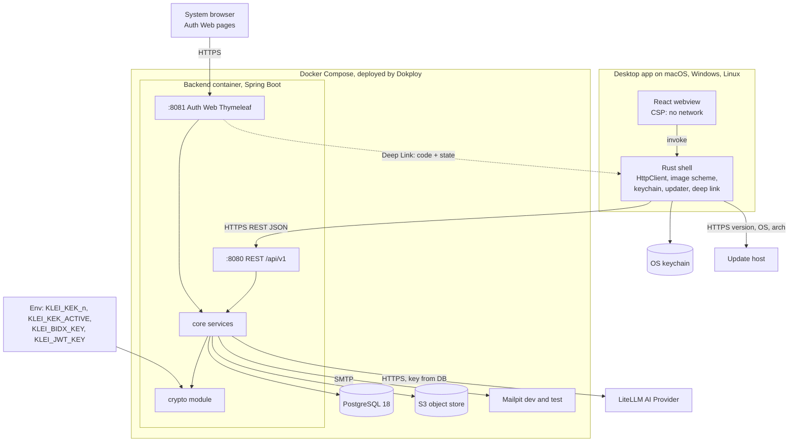
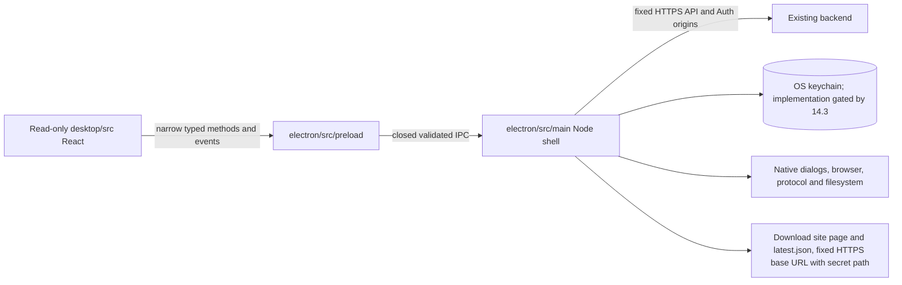

# Architecture: Klei Bridal Dashboard

Decisions live in the spine (`AD-n`). This document adds the diagrams, data model, contracts and ADR bodies the spine only points at. Where they differ, the spine wins. Numbering: `AD-n` are rules in the spine; `ADR-n` are reasoned decisions in §10, mapped to their `AD` there.

Revised 2026-11-10 (course correction, `docs/planning-artifacts/sprint-change-proposal-2026-11-10.md`): vision check of each Upload Group (§8.1, ADR-17), TOTP two-factor (§6.1, ADR-19), Away Message sending and email notifications with a digest (§8.2, ADR-18), staged Review save (`POST /uploads/{id}/commit`, §7.2). New columns land in migration V23 or later. The spine (`AD-n`) is not yet updated for these; the Architect decides whether any of them needs a new `AD`. The S-1 note in §8.1 is unchanged.

## 1. Assumptions and open questions

Assumptions (A-n) are built on until corrected. Open questions (OQ-n) need a human.

| ID | Assumption |
| --- | --- |
| A1 | One backend instance. Auth codes, login rate limits, revocation state and Auth Web sessions are in memory. A deploy stops the old container before starting the new one, so two versions never overlap; sign-in in flight during a deploy is retried by the user. Scale-out would move this state to the DB. Fine for about 5 users. |
| A2 | Day buckets for the date filter use UTC days. Gowns uploaded within a few hours of midnight may sit in the neighbouring bucket for a user in another timezone. |
| A3 | "Unread" is one flag per Inquiry for the whole Workspace, not per User (AD-21). |
| A4 | Production domains exist or are created in Dokploy: one for the API, one for the Auth Web. |
| A5 | The developer machine installs Rust (rustup) and uses `./mvnw`; no global Maven needed. JDK 25 LTS replaces the installed Java 27. A human developer sets up toolchain and release accounts (user, unconfirmed). |
| A6 | A Photo is at most 25 MB, so single-shot AES-GCM per object and one in-memory buffer per request is safe. |
| A7 | The `seq` ordering columns on six tables are plaintext (order, not time). See OQ-2. |
| A8 | Layout and visual decisions in `docs/ux-spec.md` are final; this document adds nothing visual. |
| A9 | The Dashboard shows Inquiry figures only to holders of Reply Permission; moving an Inquiry out of Closed needs the Close Permission. The PRD is silent on both. |
| A10 | Dokploy features beyond "deploy a compose app from GitHub with env vars and domains" (rolling deploy, scheduled backups, one-off `compose run`) are unverified and not relied on. |

| ID | Open question or decision | Status |
| --- | --- | --- |
| OQ-1 | Object store. `minio/minio` is archived (2026-04-24). The user chose SeaweedFS. | Resolved 2026-11-08. Smoke-tested with the planned S3 calls. Compose sets `-volume.max=0` (§9.1) |
| OQ-2 | Plaintext `seq` columns on six tables (gown, inquiry, message, notification, audit_entry, ai_usage). | Accepted 2026-11-08 |
| OQ-3 | Update host. The repository must be private, so GitHub Releases cannot serve updates without credentials. Decision: a small public releases repo holding only signed installers and `latest.json`, filled by `tauri-action` from the private repo's CI (§9.4). Rejected: the backend serves both with an `Authorization` header (extra endpoint and storage). | Resolved 2026-11-08: public releases-only repo approved |
| OQ-4 | Hibernate listener instead of `AttributeConverter` (§5.3). | Accepted 2026-11-08 |
| OQ-5 | Offline copy of the KEKs, `KLEI_BIDX_KEY` and `KLEI_JWT_KEY`, and rotation cadence. | Cadence accepted 2026-11-08: yearly and on staff exit. Holder not named; the operator (the user) until told otherwise |
| OQ-6 | NFR-1 readings and accepted leakage: (a) `dek_id` is the key version per ciphertext; (b) blind indexes leak group sizes and word frequency; (c) plaintext FKs and S3 `LastModified`; (d) HKDF per-column keys. | Accepted 2026-11-08 |

Also outstanding, not blocking design: a production SMTP provider is needed before go-live (owner: operator).

## 2. Component view



| Component | Owns | Never does |
| --- | --- | --- |
| React webview | Rendering, local UI state, form state, unsent Draft and Upload review in memory | Network calls, tokens, crypto, disk cache of content |
| Rust shell | Single HTTP client, token state and refresh, keychain, image proxy, upload and zip, updater, Deep Link handler | Show a credential form |
| API (8080) | JSON endpoints, authorization, validation, paging | Serve HTML |
| Auth Web (8081) | Sign-in, Invitation, verify, reset pages, authorize endpoint | Serve JSON business data |
| `core` | Domain rules, transactions, ports (`AiProviderPort`, `MailPort`, `ObjectStorePort`, `NotificationPort`), single writers (`AuditService`, `InquiryStateService`) | Import crypto primitives |
| `crypto` | Envelope, KEK ring, blind index, password and token primitives, listener, object cipher | Know any entity by name |
| PostgreSQL | Ciphertext and allowlisted plaintext only | Hold a key |
| Object store | Ciphertext objects under random UUID keys | Hold a key, a filename or a content type |
| Mailpit | Catch dev and test mail | Run in production |

Rust command set (AD-10, closed): `api_request(method, path, body)`, `sign_in`, `sign_out`, `upload_files(kind, targetId)` (`kind` is `photo` with the batch id or `attachment` with the Inquiry id; opens the file dialog, reads files, uploads each with its own `Idempotency-Key`, emits progress events), `export_gowns(ids ≤ 100)` (opens the save dialog, fetches photos one by one, writes the zip with sanitized names), `check_update`, `install_update`, `set_dirty(bool)`.

## 3. Repo layout and build

```text
/
  .gitignore  README.md
  backend/
    pom.xml                      # parent: Boot 4.1.2 BOM, Kotlin 2.3.21, JDK 25 toolchain
    mvnw  .mvn/
    crypto/   core/   app/       # modules, dependency app -> core -> crypto
    app/src/main/resources/db/migration/V1__baseline.sql ...
    app/src/main/resources/templates/   # Thymeleaf
    app/src/main/resources/static/      # tokens.css (generated), fragment.js, Inter font files
  desktop/
    package.json  vite.config.ts
    src/                         # React + TypeScript
    src-tauri/                   # Rust: Cargo.toml, tauri.conf.json, src/
  infra/
    docker-compose.yml  docker-compose.dev.yml  Dockerfile  .env.example
    ci/                          # build, release, smoke, perf scripts
  docs/
    prd.md  ux-spec.md  architecture.md
    api/openapi.json             # committed snapshot, drift-tested
    epics/  stories/
```

| Command | What it proves |
| --- | --- |
| `cd backend && ./mvnw verify` | Unit and integration tests (Testcontainers PostgreSQL), ArchUnit, column allowlist and envelope shape, leak suite, blind-index enum test, OpenAPI drift |
| `cd desktop && npm test && (cd src-tauri && cargo test)` | UI tests (Vitest), Rust unit tests |
| `docker compose -f infra/docker-compose.yml up -d --wait` then `infra/ci/smoke.sh` | Stack boots, `/health/ready` green, sign-in round trip, one upload |
| `infra/ci/perf.sh` | Seeded 5,000-Gown timing against the NFR-2 targets (AD-17) |
| `cd desktop && npm run tauri build` | Installer for the host OS |

Tokens: `backend/app/src/main/resources/static/tokens.css` is generated from `DESIGN.md` by a script in `infra/ci/`, and `desktop/` imports the same file, so the app and the Auth Web share one source.

## 4. Data model

### 4.1 Rules (from AD-3, AD-5, AD-6, AD-18, AD-19)

- Column kinds: `id`/`*_id` UUIDv4 (plain), `seq` bigint order key (plain, six tables only, OQ-2), `version` bigint optimistic lock (plain), `generation` (plain, `data_key` only), `*_ct` bytea envelope (AD-3), `*_bidx` bytea blind index, envelope columns `wrapped_dek` and `kek_version` on `data_key` and `stored_object` only. Nothing else exists. A schema test enforces it, and the leak suite checks every `_ct` value parses as a padded envelope.
- Every `*_ct` column is bound to its AAD `version|dek_id|table|column|rowId` by the Hibernate listener. Copying a ciphertext to another row or column fails to decrypt. Table and column in the AAD are logical names from annotations, so a Flyway rename does not break data.
- `FieldCodec` serializes booleans, numbers, enums, dates and structured values (AD-3) before encryption. A date is `*_at_ct`. Enum-like fields and booleans are padded by the envelope, so their length is constant.
- Foreign keys are plain UUIDs. They reveal which rows belong together (a Gown has 4 Photos, a Message has an author or none), not what they are. Accepted: required for joins at 100k photos (OQ-6c).
- Mutable rows have `version` (AD-18). `PATCH` and `PUT` carry `If-Match`.
- Deleting a row deletes its `stored_object` rows in the same transaction and its S3 objects in `afterCommit`; the sweep (AD-7) catches failures.

### 4.2 Blind indexes (the complete list)

`HMAC-SHA-256(HKDF(KLEI_BIDX_KEY, "bidx|v1|" + domain), canon(value))`, exact match only. `canon` = NFKC, collapse whitespace, trim, `lowercase(Locale.ROOT)`. One `BidxDomain` per row below; a test compares this table with the enum.

| `BidxDomain` | Columns | Value hashed | Serves | What a DB reader learns |
| --- | --- | --- | --- | --- |
| `APP_USER_EMAIL` | `app_user.email_bidx` | email | Sign-in, Invitation uniqueness (FR-4, FR-35) | Whether two rows share an email. Unique anyway. |
| `CLIENT_EMAIL` | `client.email_bidx` | email | Match repeat Inquiries to one Client (FR-23) | Repeat contact is visible as one row. |
| `INQUIRY_STATUS` | `inquiry.status_bidx` | `new` / `replied` / `closed` | Status filter, sidebar count (FR-19) | Three row groups and their sizes; not which is which (padding hides the value length). Accepted (OQ-6b). |
| `INQUIRY_UNREAD` | `inquiry.unread_bidx` | `1` / `0` | Unread count (FR-7) | Two groups and sizes. Accepted (OQ-6b). |
| `GOWN_DAY` | `gown.day_bidx` | UTC `yyyy-MM-dd` of creation | Date filter (FR-14); `DayBucket.lastN` | Gowns created the same day, so an upload histogram. Accepted (OQ-6b). |
| `GOWN_TERM` | `gown_term.term_bidx` | one word of name, Silhouette, Fabric | Search (FR-28) | Term frequency and co-occurrence; no words. A DB reader with public vocabulary can guess frequent words. Accepted (OQ-6b). |
| `INQUIRY_TERM` | `inquiry_term.term_bidx` | one word of Client name or subject | Search (FR-28) | Same. |
| `CREDENTIAL` | `auth_credential.secret_bidx` | invite / verify / reset secret | Look up a credential from a link | Nothing: 256-bit random. |
| `REFRESH` | `refresh_token.token_bidx` | refresh token | Rotate a session | Nothing: 256-bit random. |
| `IDEM` | `message.idem_bidx`, `photo.idem_bidx` | `Idempotency-Key` | Exactly-once Reply send and Photo upload (NFR-3) | Nothing: random UUID. |

No blind index exists for Taxonomy values. The Taxonomy is decrypted in memory (tens of rows). A Gallery filter picks Taxonomy ids and queries `gown_attribute.taxonomy_value_id`. The "in use" check counts rows by that id (FR-38).

`Terms.of(text)` is the only tokenizer: split on non letters and digits, canon each, drop words over 64 characters, dedupe, cap 32 per row. Queries go through the same function and match on `count(DISTINCT term_bidx) = distinct query words`. `DayBucket.of(Instant)` is UTC `yyyy-MM-dd`; `DayBucket.lastN(n)` is today and the previous n−1 days, and the Dashboard "new this week" uses it too.

Accepted limits: exact match only; whole words only; no prefix, range or substring. A DB reader who also gets `KLEI_BIDX_KEY` can test guesses against low-entropy indexes, so the key is a separate secret from every KEK and is never stored with backups. Changing the tokenizer, canon or day bucket bumps `v1` and runs the `ReindexJob`. The 6-digit email code is not a blind index: it is HMAC'd with the `CREDENTIAL` domain key into `code_ct` and compared in constant time after the row is found by `user_id`.

### 4.3 Tables

`PK` is always `id`. Time columns are `*_at_ct`. `seq` exists only on `gown`, `inquiry`, `message`, `notification`, `audit_entry`, `ai_usage`. `version` is on every mutable table (everything except append-only `audit_entry`, `ai_usage`, `message`, `embedding`).

**Keys and objects**

| Table | Columns |
| --- | --- |
| `data_key` | `generation` (unique), `wrapped_dek`, `kek_version`. Highest `generation` encrypts new data; older rows decrypt old data. |
| `stored_object` | `id` is the S3 key. `wrapped_dek`, `kek_version`, `size_ct`, `created_at_ct`. Exactly one owner row points at it. |
| `flyway_schema_history` | Flyway's own. |

**Identity and access**

| Table | Columns |
| --- | --- |
| `app_user` | `name_ct`, `email_ct`, `email_bidx` (unique), `password_ct` (Argon2id PHC string, wrapped), `role_id`, `status_ct` (Active, Invited), `verified_ct`, `last_active_ct` (written at most hourly), `avatar_object_id`, `prefs_ct` (date format, timezone, start page, Enter-to-send, in-app and email notification toggles, digest frequency), two-factor lives in `user_totp` and `recovery_code` (below), `created_at_ct` |
| `role` | `name_ct` (Admin, Staff, Viewer) |
| `role_permission` | `role_id`, `permission_ct`. A row means granted. A role's set is replaced whole under a lock on its `role` row. |
| `permission_epoch` | One row: `epoch` (plain bigint). Bumped by any matrix, role, disable or delete change (AD-9). |
| `signature` | `user_id` (unique), `enabled_ct`, `signoff_ct`, `name_ct`, `title_ct`, `phone_ct` |
| `auth_credential` | `user_id`, `kind_ct` (invite, verify, reset), `secret_bidx`, `code_ct`, `invited_by`, `role_id`, `expires_at_ct`, `attempts_ct`. Consumed by deleting the row. |
| `refresh_token` | `user_id`, `family_id`, `token_bidx`, `expires_at_ct`, `spent_at_ct`, `successor_id`. Spent by a version-checked update; reuse after 10 s deletes the family. |

**Gallery and upload**

| Table | Columns |
| --- | --- |
| `gown` | `name_ct`, `description_ct`, `confidence_ct`, `day_bidx`, `created_by`, `created_at_ct`, `is_new_ct` |
| `gown_attribute` | `gown_id`, `taxonomy_value_id` (FK, `ON DELETE RESTRICT`). Holds no copy of the value. |
| `gown_term` | `gown_id`, `term_bidx`, unique `(gown_id, term_bidx)`. Written only by `TermIndexer` in the same transaction as the Gown (create, rename, or attribute change). A Taxonomy rename re-runs it for every Gown using that value. |
| `taxonomy_value` | `type_ct`, `value_ct` |
| `photo` | `gown_id` (null while in a batch), `batch_id`, `group_id`, `original_object_id`, `thumb_object_id`, `filename_ct`, `content_type_ct`, `size_ct`, `idem_bidx` (unique with `batch_id`), `created_at_ct` |
| `embedding` | `photo_id` (unique), `vector_ct`, `model_ct`, `dim_ct`. Deleted at Save or Discard (AD-13). |
| `upload_batch` | `user_id` (unique: one active batch per user), `phase_ct` (empty, processing, review, error), `progress_ct`, `error_ct`, `created_at_ct`. Deleted at Save or Discard. |
| `upload_group` | `batch_id`, `name_ct`, `attributes_ct` (`FieldCodec` JSON list of type/value), `description_ct`, `confidence_ct` (an unverified Group of two or more Photos is stored capped at 89, so no verified flag and no migration; ADR-17), `position_ct` |

**Inquiries**

| Table | Columns |
| --- | --- |
| `client` | `name_ct`, `email_ct`, `email_bidx` (unique), `phone_ct`, `city_ct`, `wedding_date_ct`, `source_ct`, `note_ct`, `created_at_ct` |
| `inquiry` | `client_id`, `subject_ct`, `preview_ct`, `status_ct`, `status_bidx`, `unread_ct`, `unread_bidx`, `last_message_at_ct`. `seq` is moved to a fresh `nextval` only by `InquiryStateService.touch()` on a new Message, so newest activity sorts first. |
| `inquiry_term` | `inquiry_id`, `term_bidx`, unique `(inquiry_id, term_bidx)`. Written only by `TermIndexer`; re-run when the Client is renamed. |
| `message` | `inquiry_id`, `author_user_id` (null for a Client), `direction_ct`, `body_ct`, `idem_bidx` (unique where present), `mail_state_ct` (pending, sent, failed), `sent_at_ct` |
| `attachment` | `message_id`, `object_id`, `filename_ct`, `content_type_ct`, `size_ct` |
| `draft` | `inquiry_id`, `user_id` (unique pair), `body_ct`, `updated_at_ct` |

**AI, settings, audit**

| Table | Columns |
| --- | --- |
| `ai_setting` (one row, fixed id) | `preset_ct`, `base_url_ct`, `api_key_ct`, `organization_ct`, `chat_model_ct`, `vision_model_ct`, `vision_model_adv_ct`, `embedding_model_ct`, `temperature_ct`, `max_tokens_ct`, `status_ct`, `tested_at_ct`, `sensitivity_ct`, `tone_ct`, `advanced_ct` |
| `workspace` (one row, fixed id) | `studio_name_ct`, `studio_address_ct`, `away_enabled_ct`, `away_message_ct`, `closure_schedule_ct` (kind once, weekly or daily, days, start, end, in the studio timezone) |
| `away_sent` | `client_id`, `window_bidx` (the closure window's start), `sent_at_ct`. Unique `(client_id, window_bidx)`: the row is the once-per-window guard (FR-32). |
| `ai_usage` (purposes: test, embed, describe, chat, verify) | `user_id`, `purpose_ct`, `model_ct`, `size_ct`, `outcome_ct`, `duration_ct`, `prompt_ct`, `response_ct`, `created_at_ct`. Written in its own transaction for every call, failures included. |
| `assistant_chat` | `user_id`, `title_ct`. `chat_message`: `chat_id`, `role_ct`, `content_ct`, `created_at_ct` (messages ordered in memory; a chat is small). |
| `notification` | `user_id`, `type_ct`, `target_ct`, `title_ct`, `read_ct`, `emailed_ct` (null until a notification email or digest carried it), `created_at_ct`. Written only by `NotificationPort`. |
| `audit_entry` | `ts_ct`, `actor_id_ct`, `actor_name_ct`, `action_ct`, `detail_ct`, `ip_ct`. A trigger rejects UPDATE and DELETE (FR-40). Written only by `AuditService`. |

### 4.4 Query shapes that matter

| Screen | Query | Cost |
| --- | --- | --- |
| Gallery page | `POST /gowns/query`. `gown` filtered by `EXISTS(gown_attribute WHERE taxonomy_value_id IN …)` per chosen filter and `day_bidx IN DayBucket.lastN(n)`, `ORDER BY seq DESC`, `seq < :before`, `LIMIT 48`. Decrypt 48 rows, join 4 thumb object ids each. | Index scans only; about 200 AES-GCM ops, well under the 200 ms crypto budget. |
| Count "N of M" | `count(*)` with and without the same predicates. | Same indexes. |
| Search | `POST /search`. `Terms.of(q)`, hash each word, `SELECT gown_id FROM gown_term WHERE term_bidx IN (:hashes) GROUP BY gown_id HAVING count(DISTINCT term_bidx) = :n`, same for inquiries, `LIMIT 6`, decrypt names. | Two index lookups. |
| Sidebar badge | `count(*) FROM inquiry WHERE status_bidx = :new AND unread_bidx = :true`. | Index. |
| Inbox | `POST /inquiries/query`. `seq` paging, optional `status_bidx`, decrypt 25 rows. A new Message moves a row to the top, so the client refetches page 1 and never uses `seq` as a watermark. | Index. |
| Upload grouping | Load ≤ 200 `embedding.vector_ct` of the batch, decrypt, cluster in memory using the sensitivity threshold, then (Story 10.3) one vision verify call per group of two or more Photos before the groups are stored. Confidence blends mean and minimum pairwise similarity (Story 10.2). | 200 small decrypts; up to one extra AI call per group. |
| Staff, permissions, Taxonomy, chats | Whole table (dozens of rows), decrypt, filter in memory. | Trivial. |
| Audit log | Offset paging, 50 rows per page, `seq DESC`, `count(*)` for "Page n of m". No filter in MVP. | Index. |
| AI usage | `seq DESC`, page 50. | Index. |

## 5. Crypto design

### 5.1 Pieces

All in `backend/crypto` (namespace `co.klei.crypto`) unless noted. `core` and `app` may import only the names marked public (AD-2).

| Piece | Public | Responsibility |
| --- | --- | --- |
| `KeyRing` | no | Reads `KLEI_KEK_<n>` (base64, 32 bytes), `KLEI_KEK_ACTIVE`, `KLEI_BIDX_KEY`, `KLEI_JWT_KEY` (each also as `…_FILE`). Refuses to start if a key is missing, not 32 bytes, or two keys are equal, or a key equals the DB or SMTP password. |
| `DekStore` | no | Unwraps tenant DEKs from `data_key` once, caches them in memory, creates the first one on an empty DB (`INSERT … ON CONFLICT DO NOTHING`, then re-read). An unknown `dek_id` reloads `data_key` once, then fails. |
| `CryptoService` | yes | `encrypt(plain, ColumnRef, rowId)`, `decrypt(blob, ColumnRef, rowId)`. The only class that touches JCA `Cipher`, `Mac`, `SecureRandom`. |
| `FieldCodec` | yes | The only serializer for scalars and structured values (AD-3). |
| `ObjectCipher` | yes | Frames, pads and encrypts one object with a fresh DEK; returns body and wrapped DEK. |
| `BlindIndex`, `Terms`, `DayBucket` | yes | `BlindIndex.of(domain, value)` (AD-6), tokenizer, day buckets. |
| `PasswordHasher` | yes | Argon2id via BouncyCastle (§6.1). |
| `TokenSigner` | yes | EdDSA JWT sign and verify with `kid`. |
| `SecureTokens` | yes | Random 256-bit tokens, constant-time compare, HMAC for the 6-digit code. |
| `@Encrypted`, `@EncryptedEntity`, `@BlindIndexed` | yes | Annotations that drive the listener. |
| `EncryptionListener` | no | Hibernate event listener plus `Interceptor` (§5.3). |
| `KeyRotation` | yes | Re-wrap primitives on a raw JDBC connection. |
| `MigrationCrypto` | yes | Narrow interface for Flyway `JavaMigration` data migrations. |
| `RewrapJob` | in `app` | Pages rows and calls `KeyRotation` (§5.4). |

### 5.2 Envelope

```text
column key   K(table, column) = HKDF-SHA-256(ikm = tenant DEK, info = "col|" + table + "|" + column)
plain frame  [len:4][data][zero pad]    padded to 32-byte steps up to 256 bytes, then to the next power of two
bytea blob   [version:1][dek_id:16][nonce:12][ciphertext + tag:16]
AAD          "<version>|<dek_id>|<table>|<column>|<rowId>"      (UTF-8)
```

- `table` and `column` are the logical names in `@EncryptedEntity` and `@Encrypted`, not the DB names, so a Flyway rename cannot orphan data.
- Nonce: fresh random 96 bits per encryption, never a counter, never derived. A per-column key stays far below the 2^32 random-nonce bound (the largest column, audit `detail_ct`, reaches about 10^6 rows in years), so no write counter exists. If a column ever neared 2^31 writes, the Deferred tenant DEK replacement is the answer; `dek_id` in every blob is what keeps it possible.
- Padding: length of a ciphertext reveals no enum value, boolean or short string. Cost: up to 2x storage on large text (a 5 KB Message body takes 8 KB). Accepted.
- `dek_id` is the key version stored with each ciphertext (NFR-1 reading, OQ-6a). `kek_version` is on `data_key` and `stored_object` only, so a re-wrap never leaves a stale version inside a column.
- The app assigns the row UUID in the entity constructor, so the AAD is known at first insert.
- A decrypt failure raises `CryptoException(code)`, never the blob or AAD. The API answers 500 `crypto_failure`; it never returns an empty value.
- Copying a blob to another row or column fails the GCM tag check. The leak suite does this on purpose (§5.7).

`FieldCodec` formats (canonical, so a value compares the same after a round trip): String UTF-8; Instant ISO-8601 UTC with millis and `Z`; Boolean `1`/`0`; numbers invariant-locale ASCII; enums lowercase `snake_case`; structured values `camelCase` JSON of one `@Serializable` class with a top-level `v` field.

### 5.3 Listener, not `AttributeConverter` (ADR-3, OQ-4)

`AttributeConverter.convertToDatabaseColumn(attr)` sees only the attribute value. It cannot see the table, column or row id, so it cannot build the AAD NFR-1 asks for. Encryption therefore runs in a Hibernate listener driven by `@Encrypted`:

- Entity layout: a mapped `internal var nameCt: ByteArray?` (`name_ct`) plus a `@Transient @Encrypted var name: String`. Feature code reads and writes `name` only.
- **Load.** A `PostLoadEvent` listener decrypts the entity's `@Encrypted` fields into the transient properties and keeps a snapshot of the plaintext in a non-persisted base-class field. Lists read through `@Immutable` view entities that expose only the fields a screen needs (AD-19), so a 48-row page decrypts about 200 values.
- **Flush.** `Interceptor.findDirty` marks a `*_ct` property dirty only when its plaintext differs from the snapshot; `PreInsert` and `PreUpdate` listeners write ciphertext into the event state and the entity. An unchanged field keeps byte-identical ciphertext (no churn, no needless WAL).
- **Blind indexes.** `@BlindIndexed(domain = …, of = "email")` fills `<name>_bidx` in the same step from the same plaintext.
- **Rules (ArchUnit, AD-19).** Entities with `@Encrypted` fields are written only through the entity API. JPQL or native `INSERT`/`UPDATE` on a table with `_ct` or `_bidx` columns is forbidden outside repositories marked `@RawCiphertext` (re-wrap, leak tests); deletes by id are allowed. No `select new`, no entity `toString()` or data-class equality over decrypted fields.
- Queries cannot filter on an encrypted field and never could; filters go through `*_bidx`, FKs or in-memory work (§4.4).

Story 1.3 proves it: insert, load and decrypt; update one field changes only that column's bytes; an unchanged save changes none; a blob copied to another row or column fails; the schema test passes. **Fallback if this fails and the user agrees:** a plain `AttributeConverter` with AAD `version|dek_id|table|column` and the row id placed inside the encrypted frame, checked against the entity id in `@PostLoad`. Same swap protection; the id is checked after decrypt instead of as AAD.

### 5.4 Key rotation (FR-41, AD-4)

Four deploys, one step each. Reads keep working at every step.

| Step | Operator action | System behaviour |
| --- | --- | --- |
| 1 | Add `KLEI_KEK_n+1` to the environment, deploy | Boot accepts both KEKs |
| 2 | Set `KLEI_KEK_ACTIVE=n+1`, deploy | New DEKs and objects are wrapped with `n+1`; old rows still unwrap with `n` |
| 3 | Admin presses Re-wrap (`POST /api/v1/admin/keys/rewrap`, `PERM_KEY_ROTATE`) | Refused unless active is the highest configured KEK. `RewrapJob` pages `data_key` and `stored_object` rows with `kek_version < active`: unwrap with the old KEK, wrap with the new (AAD `dek|<id>`), update by raw JDBC in transactions of 500 rows. The entity listener never fires. No `*_ct` column or S3 object is touched: the DEK is unchanged. Resumable by the predicate, idempotent. Writes Audit Entry `key_rotation` with counts. |
| 4 | When `GET /api/v1/admin/keys/status` shows zero rows at the old version, remove `KLEI_KEK_n`, deploy | Boot fails with the version number if any row still references a missing KEK |

Not in MVP (Deferred, constraints kept): tenant DEK replacement, `KLEI_BIDX_KEY` rotation (needs `ReindexJob`, every blind index carries `v1`), `KLEI_JWT_KEY` rotation (every JWT carries `kid`). KEK, `KLEI_BIDX_KEY` and `KLEI_JWT_KEY` copies live offline, apart from the backups (OQ-5). Losing every KEK copy loses all data; the operations doc says so in its first paragraph.

`PERM_KEY_ROTATE` is a system Permission, Admin-only, outside the editable matrix (PRD delta recorded in §12). The editable set is nine: the PRD's eight plus `PERM_VIEW_GALLERY` (§6.3).

### 5.5 Object encryption (AD-7)

Per Photo upload:

1. The API receives one file (≤ 25 MB). Type comes from magic bytes (JPEG, PNG, WebP), never the header. The decoder refuses headers over 40 megapixels; at most two decodes run at once.
2. Decode with `ImageIO` (TwelveMonkeys for WebP), reject on failure, build a 480 px JPEG thumbnail with metadata stripped. The original is stored as uploaded. Plain bytes exist only in this request's memory.
3. `ObjectCipher` encrypts original and thumbnail with two fresh DEKs. Body `[version:1][nonce:12][ciphertext + tag]`, plaintext framed and padded to 64 KB steps, AAD `obj|<bucket>|<objectId>`.
4. `PutObject` under random UUID keys (Content-Type `application/octet-stream`, no user metadata, no tags). Then, in one DB transaction, insert both `stored_object` rows and the `photo` row. If the commit fails, the objects are deleted.
5. Read: the API fetches the object, decrypts, and streams plaintext over TLS to the Rust shell with a fixed Content-Type and `nosniff`. The shell serves it to the webview through the `klei-img://` scheme, so the webview needs no network permission and nothing is written to disk.
6. Delete: commit the row delete, then delete the object in `afterCommit`. A nightly sweep removes objects with no `stored_object` row and `stored_object` rows with no owner, only if older than 24 h. Each object has one owner (`photo.original_object_id`, `photo.thumb_object_id`, `attachment.object_id`, `app_user.avatar_object_id`).
7. The JVM runs with `ExitOnOutOfMemoryError`, no heap dump, and a container memory limit.

The S3 `LastModified` header is plaintext metadata and an accepted leak (OQ-6c).

### 5.6 What never contains plaintext

| Place | Rule | Test |
| --- | --- | --- |
| PostgreSQL tables | AD-5 allowlist; every `_ct` and `_bidx` value is a padded envelope | Schema test; leak suite dumps all tables |
| WAL, backups | Ciphertext only because the tables are | Covered by the table test |
| S3 | Ciphertext bodies, random keys, no metadata | Leak suite lists keys, reads bodies and metadata |
| Logs and access logs | Ids, codes, counts, durations; method and status only (AD-14) | Leak suite scans captured output |
| Error bodies | problem+json with field names only | Contract test asserts no echoed input |
| Mail | PRD §7.1 templates; Reply is the only mail with content | Leak suite reads Mailpit via its API |
| Desktop disk | Refresh token in the OS keychain (or process memory only when the User chose "Continue without saving" and in debug builds); nothing else persisted | Rust test asserts no file writes outside the update download |
| Heap dumps, swap | Out of scope (host hardening) | Documented |

Plaintext that exists on purpose, as the PRD's NFR-1 allows or the user must accept: UUID keys and FKs, `seq` on six tables, `version`, `generation`, `kek_version` and wrapped DEKs, S3 `LastModified`, blind-index equality groups (§4.2).

### 5.7 Leak suite (FR-42, AD-17)

`LeakSuiteIT` runs in `./mvnw verify` on Testcontainers PostgreSQL, Mailpit and the same pinned SeaweedFS image as production (OQ-1).

1. Bootstrap an Admin. Through the API create a Staff User, a Client, an Inquiry, a Reply with attachment, a Gown (name, description, attributes), a Taxonomy value, AI settings (name, URL, key), an Assistant chat, an Upload Batch against a stub AI provider, and an audit-producing action. Every string carries a unique Sentinel such as `SENT-7f3a-…`, in plain, base64, hex and URL-encoded forms.
2. Drive failure paths: failing SMTP, stub AI error, malformed JSON, oversize upload, wrong-type upload.
3. Dump every table with `COPY … TO STDOUT` and `pg_dump`, decode `bytea` as text and hex. List every S3 key, read every body and its metadata. Read the captured application log, the Tomcat access log and every Mailpit message.
4. Fail if any Sentinel appears. A system mail may carry its recipient address only. Fail if any column is outside the allowlist or any `_ct`/`_bidx` value is not a padded envelope.
5. Swap two ciphertexts between rows and between columns; assert decryption fails.
6. Rotate to `KLEI_KEK_ACTIVE=2`, re-wrap, repeat steps 3 and 4.

## 6. Authentication and authorization

### 6.1 Flow (AD-8)

```mermaid
sequenceDiagram
  participant U as User
  participant D as Desktop (Rust)
  participant B as System browser
  participant W as Auth Web :8081
  participant A as API :8080
  U->>D: Sign in
  D->>D: code_verifier, S256 challenge, state
  D->>B: open https://auth.../authorize?client=desktop&challenge&state&redirect
  B->>W: GET /authorize
  W->>B: login page (always asks for the password)
  U->>W: email + password (+ CSRF)
  W->>W: verify Argon2id; if two-factor is on, ask for the TOTP or a recovery code (ADR-19); issue code (60 s, bound to client, redirect, challenge)
  W->>W: destroy the cookie session
  W->>B: 302 redirect?code&state
  B->>D: Deep Link klei://auth/callback (single-instance forwards)
  D->>D: check state
  D->>A: POST /api/v1/auth/token {code, verifier}
  A->>D: access JWT 15 min + refresh token
  D->>D: access token in memory, refresh token in OS keychain
```

- `redirect` is parsed and compared exactly: `klei://auth/callback`, or `http://127.0.0.1:<1024-65535>/callback` with no userinfo and no query. Anything else is a 400 page, never a redirect. The loopback form is the fallback where the OS cannot register the scheme (Linux AppImage without desktop integration, spike S-2): the shell listens on that port for one request.
- The code is single use and held in memory (A1). `/authorize` never signs in silently; its cookie session lives only for that flow.
- **Access token.** JWT, EdDSA, `kid`, 15 min, claims `sub`, `perms[]`, `sid`, `epoch`. Per request the API checks that `iat` is not before server start, that `sid` is not revoked, and that `epoch` equals the current permission epoch. Failure is 401 `token_stale`; the shell refreshes once, retries once, then shows the Session expired state and clears the keychain entry. A refresh reloads the user, refuses a disabled one and re-reads the matrix. So a Role or Permission change, a disable or a delete takes effect on the next request (FR-35), not in 15 minutes.
- **Refresh token.** Opaque 256-bit, hash stored (`token_bidx`), rotating. Lifetime 24 h, or 30 days with Keep me signed in. A spent token is accepted for 10 s and returns the same successor (two windows racing); later reuse revokes the whole family and writes an Audit Entry. Password change, reset, user disable or delete, and a Role change revoke the user's families. Sign out revokes the family and the shell deletes the keychain entry.
- **Revocation state is in memory** (A1) and a restart invalidates every access token (`iat` before start), so all clients refresh once after a deploy.
- **Rate limits** (in memory, A1): 5 failed sign-ins per account and 20 per IP in 15 minutes, then exponential delay; same body as a wrong password. Only a lockout writes an Audit Entry. Verification code: 5 attempts, 15 minutes. Invitation valid 7 days; reset link 30 minutes (PRD FR-5).
- **No enumeration.** Sign-in, reset and Invitation responses never reveal whether an email exists. A dummy Argon2id verify runs for unknown emails and mail is sent asynchronously, so timing does not differ.
- **Argon2id.** m=64 MiB, t=3, p=1 (BouncyCastle), 16-byte salt, PHC string, then wrapped by the envelope. Maximum password length 128; at most two hashes run at once. Parameters live in the string, so a rehash on login can raise them.
- The client IP for rate limits and audit comes from one `ClientIp` resolver (one trusted proxy hop, AD-1).

### 6.2 Auth Web pages

| Route (8081) | Wireframe | Notes |
| --- | --- | --- |
| `GET /authorize` | n/a | Validates `client`, `challenge`, `state`, `redirect`; starts the flow |
| `/login` | A1 | Email, password, Keep me signed in (sets the refresh lifetime) |
| `/login/code` | n/a | Second step when the User has two-factor on (FR-44, ADR-19): 6-digit code or a recovery code. Reachable only with a password-verified, single-use, 5-minute step token held in memory. |
| `/invite` | A2 | Token arrives in the URL fragment; shows inviter and Role; sets name and password |
| `/verify` | A3 | 6-digit code or link, Resend |
| `/forgot`, `/reset` | A4, A5 | Anti-enumeration message; reset token in the fragment |
| `/return` | A6 | "Return to Klei Bridal" button for when the Deep Link did not fire |

Mail links carry their token in the URL fragment, which neither Tomcat nor the proxy logs. A same-origin script (`/static/fragment.js`, allowed by CSP) copies it into a hidden form field and clears the fragment with `history.replaceState`; the form posts it. Pages are server-rendered Thymeleaf with the shared `tokens.css` and bundled Inter (no CDN). Headers: `Content-Security-Policy: default-src 'self'; frame-ancestors 'none'`, `Referrer-Policy: no-referrer`, `Cache-Control: no-store`. CSRF token on every POST. Cookie `__Host-` prefix, HttpOnly, Secure, SameSite=Lax. Auth mail holds a link or code and generic text only.

### 6.3 Authorization (AD-9)

Every endpoint declares `@PreAuthorize("hasAuthority('PERM_…')")`, `@PermitAll`, or `@TokenAuthorized` (the one-time `ai-fetch` URL only). An ArchUnit test fails on any other. No check uses a role name.

| Permission authority | Default Admin | Default Staff | Default Viewer | Guards |
| --- | --- | --- | --- | --- |
| `PERM_VIEW_GALLERY` | yes | yes | yes | Gallery read, Gown photos, export, Search over Gowns, Dashboard Gown figures |
| `PERM_UPLOAD_IMAGES` | yes | yes | no | Upload endpoints |
| `PERM_EDIT_GOWN` | yes | yes | no | `PATCH /gowns/{id}` |
| `PERM_DELETE_GOWN` | yes | no | no | `POST /gowns/delete` |
| `PERM_REPLY` | yes | yes | no | Inquiry read, Reply, Draft, Client edit, `POST /inquiries`, Assistant |
| `PERM_CLOSE_INQUIRY` | yes | yes | no | Set status Closed, and move a Closed Inquiry back |
| `PERM_MANAGE_STAFF` | yes | no | no | Staff, Roles |
| `PERM_AI_SETTINGS` | yes | no | no | AI settings, usage log, Taxonomy edits |
| `PERM_VIEW_AUDIT` | yes | no | no | Audit log |
| `PERM_KEY_ROTATE` | yes | no | no | Key status and re-wrap (system Permission, not in the editable matrix; Admin column locked) |

- Viewer has no Inquiries and no Assistant (UX A-UX16), so Inquiry read needs `PERM_REPLY`. Gallery read needs `PERM_VIEW_GALLERY`. Search returns Gowns to holders of `PERM_VIEW_GALLERY` and Inquiries to holders of `PERM_REPLY`; a caller with neither gets 403.
- The Dashboard returns Gown figures to holders of `PERM_VIEW_GALLERY` and Inquiry figures to holders of `PERM_REPLY`; a block the caller may not see is absent. [ASSUMPTION, A9]
- **No access, no sign-in.** If a User's Role holds no Permission at all, the Auth Web refuses the sign-in with "Your account has no access yet. Ask an admin.", issues no code, and writes an Audit Entry; refresh refuses the same way. Default Viewer holds `PERM_VIEW_GALLERY`, so it signs in and sees the Gallery only; an Admin can switch that off to lock a Role out. The Admin Role is locked and always holds every Permission.
- A User cannot move an Inquiry out of Closed without `PERM_CLOSE_INQUIRY`; a Client message reopens it automatically (AD-21). [ASSUMPTION, A9]
- The matrix editor edits the nine editable Permissions (the PRD's eight plus `PERM_VIEW_GALLERY`) for Staff and Viewer. Saving a Role's set replaces it whole under a lock on the `role` row and bumps the permission epoch (AD-18). The last Admin cannot be deleted or demoted (locked parent row).
- `Forbidden` is 403 problem+json; a privileged 403 writes an Audit Entry in its own transaction (AD-21).

## 7. API contract and error model

### 7.1 Conventions (AD-11)

- Base `https://<api-domain>/api/v1`. JSON `camelCase`. `Authorization: Bearer <JWT>`. Ids UUID. Times ISO-8601 UTC.
- **No business text in URLs.** `GET` endpoints take only paging parameters. A filter or search is a `POST …/query` with a JSON body.
- **Paging.** Lists return `{ "items": [...], "next": <seq|null>, "total": <n?> }`, newest first, `limit ≤ 100` (Gallery 48, Inbox 25), cursor `before=<seq>`. The client never uses `seq` as a watermark (an Inquiry moves to the top on a new Message, so the inbox refetches page 1). `total` only where the UI shows it (Gallery, Staff). The Audit log uses offset paging (`page`, 50 rows, "Page n of m").
- **Lost updates.** Every `PATCH` and `PUT` on a mutable row requires `If-Match: <version>`; the response carries the new version. Mismatch is 409 `conflict` (FR-16).
- **Double sends.** Every create-style `POST` accepts `Idempotency-Key: <uuid>`, stored as an `idem_bidx`; a repeat returns the first result. Reply and Photo upload always send one (NFR-3). Retry of a failed mail is a separate endpoint (§8.2).
- **Spec.** Generated by springdoc, committed at `docs/api/openapi.json`; the build fails if the generated spec differs. Desktop types: `openapi-typescript docs/api/openapi.json -o desktop/src/api/schema.d.ts`; CI regenerates and diffs.
- Photo upload is `multipart/form-data`, one file per request; image reads return raw bytes with `Cache-Control: no-store`, a fixed Content-Type and `nosniff`.
- Draft undo (UX A-UX11) is a client-side re-`PUT` of the removed Draft; no endpoint of its own.

### 7.2 Endpoints

Permission column: `token` means any valid access token. Rows with a Permission also check it in the service layer (AD-9).

| Area | Method and path | Permission | FR |
| --- | --- | --- | --- |
| Health | `GET /health` (liveness), `GET /health/ready` (DB and store), on both ports | none | NFR-3, NFR-8 |
| Auth | `POST /auth/token` `{code, verifier}`; `POST /auth/refresh`; `POST /auth/logout`; `GET /me` | none; none; token; token | FR-4, FR-6 |
| Dashboard | `GET /dashboard` (adds Photos this month and Avg. reply time, last 30 days, to the existing figures) | token (Gown figures need `PERM_VIEW_GALLERY`, Inquiry figures need `PERM_REPLY`) | FR-7 |
| Upload | `POST /uploads` (create or return the caller's batch); `POST /uploads/{id}/photos`; `POST /uploads/{id}/start`; `GET /uploads/current`; `GET /uploads/{id}`; `PATCH /uploads/{id}/groups/{gid}`; `POST /uploads/{id}/groups/{gid}/split`; `POST /uploads/{id}/merge`; `POST /uploads/{id}/photos/{pid}/move`; `DELETE /uploads/{id}/photos/{pid}`; `POST /uploads/{id}/save`; `POST /uploads/{id}/commit` (all staged Review edits and the save in one transaction: groups, assignments, tags, names, descriptions, discards, each with its `version`; once Story 11.6 lands the Review screen sends this instead of the per-edit calls above); `DELETE /uploads/{id}` | `PERM_UPLOAD_IMAGES` | FR-8..FR-12 |
| Gallery | `POST /gowns/query` `{silhouette[], fabric[], days, before, limit}`; `GET /gowns/{id}`; `PATCH /gowns/{id}`; `POST /gowns/delete` `{ids}`; `GET /gowns/{id}/photos/{pid}?size=thumb\|full`; `POST /gowns/export` `{ids ≤ 100}` (streams a sequence of decrypted photos for the shell to zip) | `PERM_VIEW_GALLERY`; `PERM_VIEW_GALLERY`; `PERM_EDIT_GOWN`; `PERM_DELETE_GOWN`; `PERM_VIEW_GALLERY`; `PERM_VIEW_GALLERY` | FR-13..FR-18 |
| Taxonomy | `GET /taxonomy`; `PUT /taxonomy` (409 `conflict` with `extensions.usedBy` when a value is in use) | token; `PERM_AI_SETTINGS` | FR-38 |
| Inquiries | `POST /inquiries/query` `{status, before, limit}`; `GET /inquiries/{id}`; `PATCH /inquiries/{id}` `{status}`; `POST /inquiries/{id}/reply`; `POST /messages/{id}/retry`; `PUT/DELETE /inquiries/{id}/draft`; `POST /inquiries/{id}/attachments` (one file, `Idempotency-Key`); `GET /clients/{id}`; `PATCH /clients/{id}`; `POST /inquiries` (FR-24, a Staff user token) | `PERM_REPLY`; Closed also `PERM_CLOSE_INQUIRY` | FR-19..FR-24 |
| Assistant | `GET /assistant/chat`; `POST /assistant/chat/messages`; `DELETE /assistant/chat` | `PERM_REPLY` | FR-25..FR-27 |
| Search | `POST /search` `{q}` | token (Gowns need `PERM_VIEW_GALLERY`, Inquiries need `PERM_REPLY`; neither is 403) | FR-28 |
| Notifications | `GET /notifications`; `POST /notifications/read`; `DELETE /notifications` | token | FR-29 |
| Personal | `GET/PATCH /me/profile`; `POST /me/password`; `PUT /me/avatar`; `GET/PUT /me/signature`; `GET/PUT /me/preferences` (adds email toggles and digest frequency); `GET /me/2fa`; `POST /me/2fa/start`; `POST /me/2fa/confirm` `{code}`; `POST /me/2fa/disable` `{password, code}`; `POST /me/2fa/codes` `{password, code}` | token | FR-30, FR-31, FR-33, FR-34, FR-44 |
| Admin | `GET/POST/PATCH/DELETE /admin/users`; `POST /admin/users/{id}/resend`; `POST /admin/users/{id}/2fa/reset` (`PERM_MANAGE_STAFF`, audited); `GET/PUT /admin/roles`; `GET/PUT /admin/ai`; `POST /admin/ai/test`; `GET /admin/ai/usage`; `GET/PUT /admin/workspace` (studio name and address, Away Message, closure schedule); `GET /admin/audit`; `GET /admin/keys/status`; `POST /admin/keys/rewrap` | `PERM_MANAGE_STAFF`; `PERM_AI_SETTINGS`; `PERM_VIEW_AUDIT`; `PERM_KEY_ROTATE` | FR-35..FR-41 |
| AI image fetch | `GET /ai-fetch/{token}` on 8080 | `@TokenAuthorized`: 256-bit token, single use, 60 s, held in memory, never logged. Exists only if spike S-1 finds the data URI unsupported | FR-9 |

`GET /admin/ai` never returns `apiKey`; it returns `apiKeySet: true` and a mask `sk-••••`. Changing the Base URL scheme or host requires the key to be entered again. `POST /admin/ai/test` returns the three checks the UX spec defines:

```json
{ "checks": [
  { "id": "provider",  "label": "Provider reachable", "ok": true,  "detail": null },
  { "id": "models",    "label": "Models loaded",      "ok": true,  "detail": "12 models" },
  { "id": "embedding", "label": "Image embedding",    "ok": false, "detail": "dimension 0" }
], "status": "failed" }
```

`POST /gowns/export` takes at most 100 ids and 100 MB of photos; the shell writes the zip, so the backend never holds the archive.

### 7.3 Error model (AD-11)

`Content-Type: application/problem+json` (RFC 9457).

```json
{
  "type": "https://klei.app/problems/validation",
  "title": "Validation failed",
  "status": 422,
  "code": "validation_failed",
  "correlationId": "7c1e…",
  "fields": [ { "name": "password", "code": "too_short" } ],
  "extensions": {}
}
```

| HTTP | `code` | When | Desktop reaction (UX) |
| --- | --- | --- | --- |
| 400 | `bad_request` | Malformed JSON, bad cursor | Inline error + Retry |
| 401 | `unauthenticated`, `token_stale` | Missing or expired token; permission or session changed | Refresh once, else Session expired state |
| 403 | `forbidden` | Permission missing | "You don't have access" view |
| 404 | `not_found` | Unknown id or no access to it | Not-found block |
| 409 | `conflict` | Stale edit (`If-Match`), last Admin, Taxonomy value in use (`extensions.usedBy`) | Dialog with reason |
| 413 | `too_large` | Photo > 25 MB, batch > 200 | Rejected-files list |
| 415 | `unsupported_type` | Not JPEG, PNG, WebP | Rejected-files list |
| 422 | `validation_failed` | Field rules | Field errors |
| 429 | `rate_limited` | Sign-in or API limits; `Retry-After` header | Wait message |
| 502 | `ai_provider_failed` | Provider error or timeout; `extensions.check` names which | Error block + Retry |
| 503 | `unavailable` | DB or store down | Connection banner |
| 500 | `internal`, `crypto_failure` | Bug or key problem | Generic error + correlation id |

`extensions` has a fixed schema per `code` in the OpenAPI spec. `fields[].name` is a field name, never a value. `title` and `code` are fixed strings, never built from user input. Unhandled exceptions are logged with class, code and `correlationId` only; the response never carries a stack trace or message text. Parse and validation errors map to fixed codes (AD-14).

### 7.4 Connection-loss signals (UX handoff, NFR-3)

- The Rust shell treats a network error, a 10 s timeout and 502/503 as "offline". The banner shows after the first failure; while offline the shell calls `GET /health` every 5 s and clears the banner on success. Send is disabled while offline.
- An unsent Reply Draft and Upload review stay in React memory; a Draft is also on the server once its `PUT` succeeds. Install of an update is blocked while `set_dirty(true)` (AD-15, FR-43).
- Replies and Photo uploads carry `Idempotency-Key`, so a retry after an ambiguous failure cannot send or store twice.
- No offline content cache on disk (AD-10).
- Polling cadence (ADR-6): Upload progress 2 s while visible, inbox and sidebar badge 30 s, offline health 5 s.

## 8. AI, mail and egress

### 8.1 AI port (AD-12, AD-13)

`AiProviderPort` has `embed(image) -> vector`, `describe(images, taxonomy, tone) -> attributes+description`, `compare(images) -> partition` (Story 10.3), `chat(messages) -> text`, `listModels()`. One adapter speaks the OpenAI-compatible API to the configured Base URL (default `https://nextgen-ai.enlinka.co`). Key, URL and models are read from `ai_setting` on each call (cached 60 s, cleared on save). A call never runs inside a DB transaction. Every call writes an `ai_usage` row in its own transaction (`REQUIRES_NEW`), failures included, with a 60 s timeout and one retry.

SSRF guards on the Base URL: HTTPS only (HTTP behind a dev flag); the host is resolved once and the connection pinned to that IP; loopback, link-local, private, CGNAT, ULA and cloud-metadata ranges are refused; no redirects; response size and time caps; the provider's body is never echoed to the client. Changing scheme or host requires re-entering the key and writes an Audit Entry. The key is write-only, stored encrypted, never in `.env`.

| Use | Endpoint | Sent | Not sent |
| --- | --- | --- | --- |
| Test connection | `GET /models`, `POST /v1/embeddings` | One tiny generated test image | Any client data |
| Embedding | `POST /v1/embeddings`, model `dinov2-base`. Goes to the optional Embeddings base URL with its own key; blank means the Base URL and key above | The Photo thumbnail as `data:image/jpeg;base64,…` (S-1) | Name, attributes, user |
| Grouping | none (clustering is in memory) | n/a | n/a |
| Verify (Story 10.3) | chat/vision completion, purpose `VERIFY`, same vision model rule as Attributes | At most 8 thumbnails of one Group, labelled "Photo n of m" | Filenames, ids, client data |
| Attributes and Description | chat/vision completion | Photos of one Group, allowed Taxonomy values, tone | Client data |
| Assistant | chat completion | The user message plus context built by the backend from rows the caller can read: at most 20 items of 2 KB each | Anything not named in the question; rows the caller cannot read |

Spike S-1 (first task of the AI Upload story): confirm the endpoint accepts a base64 data URI as `input`. If not, the fallback is the one-time URL `GET /api/v1/ai-fetch/{token}` in §7.2. The PRD's example sends an image URL, so the fallback may become the primary path. Either way no image URL is persistent and bytes are decrypted only inside that response.

**S-1 status (Story 4.3).** Built on the data-URI path (`OpenAiCompatibleAdapter.embed`); `/ai-fetch` is not built. OPEN QUESTION until the operator runs a real grouping against the provider: if it rejects the data URI, `embed` fails with `bad_response` or `http_error` and the one-time URL is the next story. Tests use a loopback stub only. A real run (2026-11-10) answered `Provider error 400` to the embeddings call while `/models` passed, so the provider is reachable and the key accepted but the request shape or model is rejected; the 400 body is not read by design. A separate embeddings address and key (V22) lets an image-embedding server sit apart from the chat gateway. **Operator ruling (2026-11-10):** the embedding model and the LLM stay separate, each with its own URL and API key. Do not merge them and do not let the chat URL or key serve embeddings. Verify (ADR-17) uses the chat gateway and its vision model, never the Embeddings address. The operator reports the 400 resolved but has not named the provider, the embedding model or the fix, so the measured cause is still not recorded and the data-URI `input` shape is still proven only by the loopback stub.

Embeddings (AD-13) are stored encrypted per batch only to group that batch and are deleted at Save or Discard. There is no catalog-wide similarity in the MVP.

### 8.2 Mail port (AD-14, AD-20)

`MailPort.send(template, to, model)` over SMTP (`spring-boot-starter-mail`), built with `MimeMessageHelper`; CR/LF and path separators are stripped from subjects and file names; STARTTLS and certificate checks are required outside dev. Dev and test: Mailpit `mailpit:1025`, no auth, UI on 8025 (dev only, not published in production). Production SMTP provider: operator's choice before go-live. Templates are classpath Thymeleaf text files; each has a leak test that its output holds only the allowed variables.

| Template | Variables | Allowed content |
| --- | --- | --- |
| `invite` | link | Generic text and a link (inviter and Role are shown on the Auth Web page, not in the mail) |
| `verify` | 6-digit code, link | Same |
| `reset` | link | Same |
| `reply` | Reply body (sanitized HTML), Signature, attachments | Content mail, sent to the Client |
| `away` | Away Message text (Admin-authored), studio name | Content mail, sent to the Client once per closure window (FR-32, confirmed 2026-11-10). No inquiry content, no names of other Clients. Sent after commit through the same path as `reply`, with no retry; the `away_sent` row is written first so a crash cannot double-send. |
| `notification` | link, event kind | Generic text and a link only (FR-34, NFR-6). Real-time mode sends one per event. |
| `digest` | event kind and count per kind, link | Same. Hourly, Daily and Weekly bundle events since `last_digest_at` (ADR-18). |

Email notifications honour the per-User toggles and digest frequency in `prefs_ct`; "Never" overrides the toggles. `NotificationPort` stays the single writer of `notification`; the scheduler only stamps `emailed_ct`.

**Reply state machine.** A Reply saves the `message` row with `mail_state=pending` in one transaction (with the Inquiry state change). After commit, a send is attempted: `sent` on success, `failed` on error. `failed` shows an error toast with Retry; `POST /messages/{id}/retry` re-sends the same Message, never creates a second one. A `pending` row older than 5 minutes (a crash between commit and send) is shown as not sent, with the same Retry. Retry is user-driven only (AD-20). Auth mail is sent asynchronously for the same reason (no timing difference between known and unknown emails).

### 8.3 Egress (PRD §7.1, complete)

PostgreSQL, S3 and Mailpit are inside the compose network. Outbound from the backend: AI Provider (HTTPS) and SMTP. Outbound from the desktop: the backend and the update host. No telemetry, fonts, scripts or analytics from any origin (Inter is bundled). Compose network policy: the backend is the only service with an outbound route; PostgreSQL and the object store join an `internal: true` network. Inbound mail to the studio is not handled in the MVP (intake deferred). Two egress rows were added 2026-11-10 to match PRD §7.1: Group thumbnails labelled "Photo n of m" go to the vision model for the Verify check (§8.1), and the Away Message goes by SMTP to a Client who wrote to the studio during a closure window (§8.2).

## 9. Deployment, configuration, CI and release

### 9.1 Compose services

| Service | Image | Ports | Volumes | Notes |
| --- | --- | --- | --- | --- |
| `backend` | Built from `infra/Dockerfile` on `eclipse-temurin:25-jre` | 8080, 8081 | none (read-only root fs, tmpfs `/tmp`) | Non-root user. Healthcheck `GET /health`. Starts after `postgres` and `objectstore` are healthy. Memory limit 1 GB; JVM `-XX:MaxRAMPercentage=60 -XX:+ExitOnOutOfMemoryError`, no heap dump. Multipart limit 26 MB. |
| `postgres` | `postgres:18.6` | 5432 (dev only, loopback) | `pgdata` | `internal` network. `POSTGRES_PASSWORD` from env. |
| `objectstore` | `chrislusf/seaweedfs:4.52` (digest `sha256:57877e32bb90073b37dc109b438ba66e84fd5ed9ced5f5c04f56444ef243ce59` in production), command `server -dir=/data -s3 -volume.max=0` | 8333 S3 (dev only, loopback) | `objdata:/data` | `internal` network. Credentials from `KLEI_S3_ACCESS_KEY` and `KLEI_S3_SECRET_KEY` (container env `AWS_ACCESS_KEY_ID`, `AWS_SECRET_ACCESS_KEY`). `-volume.max` defaults to 8 volumes of 30 GB, after which writes fail silently at about 240 GB; `0` sizes it from free disk, and `-volume.minFreeSpace` keeps headroom. Healthcheck `GET :9333/cluster/status`. The backend creates the bucket at startup if missing (signed `PUT /<bucket>`). Path-style S3 addressing. |
| `mailpit` | `axllent/mailpit:v1.33.0` | 1025, 8025 (dev profile only) | none | Not in production. |

Networks: `internal` (`internal: true`: postgres, objectstore, backend) and `edge` (backend only, for outbound AI and SMTP). Restart `unless-stopped`. Production images are pinned by digest: the release checklist resolves each tag with `docker buildx imagetools inspect` and writes `image: name@sha256:…` into `docker-compose.yml`.

### 9.2 Configuration (`infra/.env.example`; the real `.env` is git-ignored)

| Variable | Meaning | Secret |
| --- | --- | --- |
| `KLEI_KEK_1`, `KLEI_KEK_2`, … | base64 32-byte KEKs | yes |
| `KLEI_KEK_ACTIVE` | KEK number used for new wraps | no |
| `KLEI_BIDX_KEY` | base64 32-byte blind-index key | yes |
| `KLEI_JWT_KEY` | EdDSA private key (base64 PKCS8) | yes |
| `KLEI_DB_URL`, `KLEI_DB_USER`, `KLEI_DB_PASSWORD` | PostgreSQL | password yes |
| `KLEI_S3_ENDPOINT`, `KLEI_S3_BUCKET`, `KLEI_S3_ACCESS_KEY`, `KLEI_S3_SECRET_KEY` | Object store | keys yes |
| `KLEI_SMTP_HOST`, `KLEI_SMTP_PORT`, `KLEI_SMTP_USER`, `KLEI_SMTP_PASSWORD`, `KLEI_MAIL_FROM` | Mail | password yes |
| `KLEI_API_BASE_URL`, `KLEI_AUTH_BASE_URL` | Public URLs (mail links, redirect checks) | no |
| `KLEI_TRUSTED_PROXY_HOPS` | Proxy hops trusted for client IP, default 1 | no |
| `KLEI_DEV_ALLOW_HTTP_AI` | Allow an `http://` AI Base URL; false except in dev | no |
| `KLEI_BOOTSTRAP_ADMIN_EMAIL`, `KLEI_BOOTSTRAP_ADMIN_PASSWORD` | Creates the first Admin at startup when none exists (FR-1) | yes |

Every secret may also be given as `<NAME>_FILE` (a mounted file). Not in the environment, ever: the AI Provider URL, key and models (entered in the AI settings screen, stored encrypted). `.env.example` holds placeholders and a hint to generate keys with `openssl rand -base64 32`; `infra/ci/gen-keys.sh` prints a full set. There are no defaults for secrets.

Backend startup checks, in order; any failure stops the boot with a code, never a value:

1. All required variables are present.
2. KEK, `KLEI_BIDX_KEY`, `KLEI_JWT_KEY` lengths; all keys pairwise distinct and distinct from the DB and SMTP passwords.
3. Crypto beans start, then Flyway migrates (data migrations use `MigrationCrypto`, AD-19).
4. Every `kek_version` in `data_key` and `stored_object` has a configured KEK.
5. Bucket reachable; encrypt-decrypt round-trip self-test.
6. First Admin: if no Admin exists, create one verified from `KLEI_BOOTSTRAP_ADMIN_*` and write an Audit Entry. Afterwards the operator removes both variables from Dokploy; the password never needs to stay in the environment.
7. Any Upload Batch left in `processing` becomes `error` (AD-20).

Health: `GET /health` is liveness (the process is up). `GET /health/ready` checks DB and store and is what the desktop offline ping and the smoke test call. Actuator exposes nothing else.

### 9.3 Dokploy

Relied on (A10): build from the GitHub repo as a Docker Compose application, inject env vars, route a domain to a service port, terminate TLS. Not relied on, unverified: rolling or zero-downtime deploy, scheduled `pg_dump` and bucket copy, one-off `docker compose run`.

- Domains: `api.<domain>` to `backend:8080`, `auth.<domain>` to `backend:8081` (A4). Only those two routes are public; no PostgreSQL, store or Mailpit port is mapped. The port guard (AD-1) plus separate hostnames mean the API is not reachable on the Auth Web domain and the reverse.
- KEKs, `KLEI_BIDX_KEY` and `KLEI_JWT_KEY` are Dokploy secrets. An offline copy of all three is kept by the operator (OQ-5, the user until told otherwise), never in the same place as the backups.
- Deploy is stop-then-start. A short outage is accepted; in-flight sign-ins fail and are retried (A1).
- **Backups.** `infra/ops/backup.sh` runs `pg_dump` first and then copies the bucket (both ciphertext), to a destination outside the Dokploy host. It runs from Dokploy's scheduler if that supports it, else from host cron. The dump-then-bucket order means every row's object exists in the copy; the script ends by listing rows whose object is missing (the integrity report). `infra/ops/restore.md` is the restore drill and must be run once before go-live. RPO ≤ 24 h, RTO ≤ 4 h.
- **Rollback.** Migrations are forward-only. Rollback is restore of the backup plus the previous image; the operations doc says a bad migration costs the data written since the backup.
- **Environments.** Dev (compose with the `dev` profile, Mailpit) and production. CI runs the same compose. No separate staging; the smoke test and the leak suite cover what staging would.
- No telemetry. Logs go to the container's stdout; metrics beyond the two health endpoints are Deferred.

### 9.4 CI and release

| Pipeline | Trigger | Steps |
| --- | --- | --- |
| Backend | every push | `./mvnw verify` on JDK 25 with Docker for Testcontainers: tests, ArchUnit, allowlist and envelope test, leak suite, OpenAPI drift |
| Desktop | every push | `npm ci`, `npm test` (Vitest, includes axe-core checks on the key screens for NFR-7), `npm run build`, `cargo test`, `cargo clippy -D warnings` |
| Contract | every push | Regenerate `openapi.json` and the TS types, diff against committed |
| Smoke | PR to main | `docker compose up -d --wait`, `infra/ci/smoke.sh`: sign in through a scripted Auth Web flow, upload one photo against the stub AI, read it back, assert the Mailpit message holds only template text |
| Performance | PR to main | `infra/ci/perf.sh`: seed 5,000 Gowns, assert the NFR-2 p95 targets |
| Desktop OS smoke | PR to main | Matrix `macos-latest`, `windows-latest`, `ubuntu-latest`: build the installer, install it, launch with `KLEI_SMOKE=1` (shows the sign-in state and exits 0 after the window is ready) |
| Release | tag `v*` | Same matrix with `tauri-action`; installers `.dmg` (arm64, x64), `.msi`/NSIS (x64), `.AppImage` and `.deb` (x64); updater `.sig` files and `latest.json` generated with `TAURI_SIGNING_PRIVATE_KEY` from CI secrets; uploaded to the update host (OQ-3: public releases-only repo, approved): `tauri-action` with `owner`, `repo` and a write token for that repo only, kept in CI secrets |

Deep Link and updater behaviour on each OS are spikes S-2 and S-3; until they find an automated check, the release checklist has a manual step per OS (open a `klei://` link, install an update, confirm the refresh token still reads).

Spike S-3 (updater on each OS), status after story 9.3: automated, the feed and signature rules (`update_tests.rs`: version and OS in the request, same version and 204 mean none, tampered or wrongly versioned package refused, dirty work refuses install); not verified on a real machine, install and relaunch (`install` replaces the running binary, so no test calls it). One line per OS, to be replaced by the first real result in `docs/release-checklist.md`:

- macOS: `.app.tar.gz` replaced in place, needs `app.restart()` after install; unsigned app may re-ask Gatekeeper after replacement. Unverified.
- Windows: installer runs and the app exits by itself during `install`; UAC prompt possible for a machine-wide install. Unverified.
- Linux: AppImage only, replaced in place and relaunched by `app.restart()`; a `.deb` install is outside the updater. Unverified.

The CI release build is `.github/workflows/release.yml`; `createUpdaterArtifacts` is switched on only by `desktop/src-tauri/tauri.release.conf.json`, so the every-push build stays a plain binary. The "Desktop OS smoke" row above installs nothing yet: it builds the binary and launches it with `KLEI_SMOKE=1`; installer install and launch are the manual checklist.

Installers are unsigned at the OS level (user decision). The install guide documents Gatekeeper (right-click Open, or `xattr -d com.apple.quarantine`) and SmartScreen (More info, Run anyway). Adding certificates later changes the build matrix only (PRD FR-43). Linux auto-update is AppImage; `.deb` is manual.

Updater key custody (AD-15): the private key lives in the CI secret store with an offline escrow copy kept next to the KEK copies; losing it strands every installed client, so a lost key means a manual reinstall. A key-rotation release is signed by the old key and embeds the new public key. The update URL is a single constant in `tauri.conf.json`; moving the host means one release signed by the old key that points at the new URL.

### 9.5 Desktop packaging notes

- `tauri.conf.json`: `identifier` `co.klei.bridal`, deep-link scheme `klei`, updater endpoint and public key, CSP `default-src 'self'; img-src 'self' klei-img: data:; connect-src 'none'; style-src 'self'; script-src 'self'; font-src 'self'` (spike S-4 confirms it with IPC and `klei-img://`).
- Capabilities allow only the eight Rust commands in §2 and the dialog plugin for open and save.
- Window minimum 1100x700 (UX).
- Idle memory target 300 MB: images load as thumbnails, the full photo only in the viewer, and the cache is a small in-memory LRU.
- Single-instance plugin forwards a second launch's Deep Link URL to the running app (Windows and Linux).

## 10. Architecture Decision Records

Each ADR gives the reasoning behind rules in the spine. The `AD` column is where the rule lives.

| ADR | AD | Decision | Status |
| --- | --- | --- | --- |
| ADR-1 | AD-1 | Kotlin framework: **Spring Boot 4.1.2** | Adopted (user) |
| ADR-2 | Stack | Frontend in Tauri: **React 19 + Vite + TypeScript** | Proposed |
| ADR-3 | AD-3, AD-19 | Encryption in a **Hibernate listener**, not `AttributeConverter` | Accepted |
| ADR-4 | AD-19 | Migrations: **Flyway** | Proposed |
| ADR-5 | AD-8 | Auth: **Auth Web + authorization code + PKCE + Deep Link**, JWT access, rotating refresh | Proposed |
| ADR-6 | AD-11 | Transport: **HTTPS REST/JSON**, polling, no realtime | Proposed |
| ADR-7 | AD-1 | One Spring Boot app with **two connectors** | Proposed |
| ADR-8 | AD-3, AD-4 | **One tenant DEK**, per-column keys by HKDF, per-object DEKs; KEK rotation re-wraps DEKs only | Accepted |
| ADR-9 | AD-5, AD-6 | **Plaintext `seq` columns** for ordering; all time values encrypted | Accepted |
| ADR-10 | AD-6 | **Blind-index search** (whole word) and day buckets | Accepted |
| ADR-11 | AD-13 | **Batch-local embeddings**, no pgvector | Proposed |
| ADR-12 | AD-10 | **Rust shell is the only network client**; tokens in keychain | Proposed |
| ADR-13 | AD-7 | **Object store behind an S3 port: SeaweedFS** | Accepted |
| ADR-14 | AD-15 | **Update via the Tauri updater**, public releases-only repo (OQ-3) | Accepted |
| ADR-15 | AD-17 | **Verification in the build** (leak suite, allowlist, ArchUnit) | Proposed |
| ADR-16 | AD-18, AD-20, AD-21 | **In-memory auth state, no job table, single writers** | Proposed |
| ADR-17 | AD-12, AD-13 | **Vision verify inside the grouping step** (Epic 10) | Proposed |
| ADR-18 | AD-18, AD-20 | **Scheduled email digest on the in-process scheduler** (Story 11.13) | Proposed |
| ADR-19 | AD-2, AD-7 | **TOTP second factor on Auth Web** (Story 11.14) | Proposed |

**ADR-1 Framework.** The user chose Spring Boot over Ktor. Boot gives Hibernate event hooks (ADR-3), Thymeleaf (Auth Web), mail, resource-server JWT validation and Testcontainers support without glue. Cost: heavier startup and memory than Ktor; acceptable for one container serving about 5 users.

**ADR-2 Frontend.** Tauri takes any web stack; the UX has about 25 screens, a rich-text composer, tables and a drawer. Decision: React 19, Vite 8, TypeScript 5.9 (7.x conflicts with the `openapi-typescript` peer range), TanStack Query for server state, react-router, TipTap for the composer (Reply allow-list per FR-21, sanitized again on the server), plain CSS from the shared `tokens.css`, no UI kit. Alternatives: Svelte (smaller, but TipTap and the ecosystem fit React), Vue (equal, no reason to prefer). Consequence: DOMPurify on display.

**ADR-3 Listener.** See §5.3 for the mechanism and the recorded fallback.

**ADR-4 Flyway.** Plain SQL files, a first-class Boot starter, version pinned by the BOM. Liquibase's changelog formats and rollback tags add something nobody here needs; migrations are forward-only. Consequence: encrypted-column changes need a data migration, not just SQL; those run as Kotlin `JavaMigration` classes through `MigrationCrypto`.

**ADR-5 Auth.** The user asked for sign-in on a separate web page that returns to the app. OAuth 2.0 authorization code with PKCE is the standard for that (RFC 8252), so there is no custom protocol to get wrong. The Auth Web is the authorization endpoint and login UI; the API is the resource server. Not adopted: Spring Authorization Server (one client, one user store; revisit if a second client appears). Consequence: the shell runs the PKCE steps and is tested with a fake browser in Rust tests.

**ADR-6 Transport.** Nothing in the wireframe needs push: Upload progress is polled, the inbox and badge are polled, offline health is polled (§7.4). SSE or WebSocket would add a second auth path.

**ADR-7 Two connectors.** Same JVM, same DB pool, same password and token code; two ports satisfy "different port to backend" (user). The port guard plus separate domains give the isolation.

**ADR-8 Keys.** NFR-1 allows per-record or per-tenant DEKs. One Workspace means one tenant DEK. A single key over about 10^7 ciphertexts would sit near the random-nonce bound over years, so each column gets its own key from HKDF; no counter is needed. Objects get their own DEK because they are large and deleted individually, which gives crypto-erase per object.

**ADR-9 Ordering and time.** "Newest first" and keyset paging need an order, and encrypted timestamps cannot be indexed. A `seq` on six tables reveals order and row count, not time, content or who. NFR-1 lists unencrypted exceptions and `seq` is not on it; the user accepted it on 2026-11-08 (OQ-2). If refused, the fallback is decrypt-and-sort in memory, which misses the 1.5 s Gallery target beyond about 2,000 Gowns.

**ADR-10 Search.** Whole-word term indexes (PRD FR-28, accepted by the user). A DB reader sees term frequency per Gown, not the words. Not offered: n-gram indexes (bigger leak and storage), prefix search. Status, unread and day-bucket indexes leak group sizes; accepted by the user (OQ-6b). The alternative for status and unread is decrypting a bounded set in memory, which costs the inbox its count in the sidebar at 50k Inquiries.

**ADR-11 Embeddings.** At 50k photos a catalog-wide similarity needs plaintext vectors in pgvector (violates NFR-1) or decrypting everything per query. The MVP needs similarity only to group one Upload Batch. "Suggest gowns" (FR-26) reads Gown text, not vectors.

**ADR-12 Rust shell.** Tokens must be in the keychain (brief). A webview that holds no token and cannot open a socket cannot leak either through an XSS. Cost: every API call goes through one `invoke`.

**ADR-13 Object store.** The backend talks plain S3 through `ObjectStorePort` (AWS SDK v2). Every object is already ciphertext, so the store needs no server-side encryption or vendor feature, and swapping it is one compose line. The `minio/minio` community repo was archived on 2026-04-24 and no pullable image was found, so the user chose SeaweedFS (Apache-2.0, OQ-1, 2026-11-08). The brief named MinIO; the user replaced it. Checked on 2026-11-08 with `chrislusf/seaweedfs:4.52`: create bucket, put, head, get, list, delete all work through plain SigV4 S3, and wrong credentials are denied. Gotchas recorded in §9.1: `-volume.max` and `-volume.minFreeSpace`. Rejected: AIStor Free (vendor licence), RustFS (younger).

**ADR-14 Updates.** `tauri-plugin-updater` verifies a minisign signature against the key embedded in the app, independent of OS signing. The host choice only changes the endpoint URL. OQ-3: the source repo is private, so its Releases cannot serve an unauthenticated updater. Decision: a small public repo that holds only signed installers and `latest.json` (no source, no secrets; integrity rests on the signature, not on the host). The app never embeds a GitHub token. Rejected alternative: the backend serves both with an `Authorization` header; it adds an endpoint and a storage location.

**ADR-15 Verification.** Encryption claims are tests: allowlist, envelope shape, ArchUnit, leak suite (§5.7), contract drift, all inside `./mvnw verify`.

**ADR-16 State and writers.** With one instance, in-memory auth codes, rate limits and revocation need no table; the price is stop-then-start deploys and a refresh for every client after a restart. No job table: every scheduled task is idempotent and resumable by a predicate. Audit, Notification and Inquiry state each have one writer so two stories cannot apply different rules to the same data.

**ADR-17 Vision verify.** Embeddings rank colour, fabric and pose above gown identity, and a mean-similarity confidence hides one wrong Photo in a Group (course correction 2026-11-10). Decision: after `Clusterer.cluster`, one `compare` call per Group of two or more Photos asks the vision model to partition the Photos into the same exact gown; a valid partition splits the Group and each part is rescored; an invalid answer or a provider error leaves the Group unverified and capped at 89 (Medium); the batch never fails because of verify. It runs inside step 2, so there is no new step number and no new resume predicate: Groups are stored only after verify. Costs about one vision call per Group (estimate 20k to 50k tokens per 30-Photo batch). Alternatives: raise the default sensitivity (fragments real Groups first), a second embedding model (unproven; Story 10.1 measures it), forcing manual confirmation (blocks Save and hides nothing). Consequence: Retry skips clustering once Groups exist, so an unverified Group is not re-verified from Retry.

**ADR-18 Digest scheduler.** Email notifications and a digest (FR-34) need time-based work. Decision: one `@Scheduled` job every 5 minutes, idempotent by a per-user `last_digest_at` cursor, using `select … for update skip locked` so a second instance cannot double-send (extends ADR-16: still no job table). Mail carries notification titles only; a failed send is logged by class name and not retried because the in-app Notification is the record. Alternative: a job table with retries (more failure modes for one mail kind).

**ADR-19 Two-factor sign-in.** FR-44 adds TOTP (RFC 6238, SHA-1, 6 digits, 30 s step, one step of drift) built on `javax.crypto.Mac`. Built as two tables, not columns on `app_user`: `user_totp` (`secret_ct`, `state_ct` PENDING, ACTIVE or RESET, `last_used_step_ct`; one row per user) and `recovery_code` (`hash_ct` Argon2id, `used_at_ct`; 8 per set). Every value is a `_ct` envelope (NFR-1); the secret is never returned after enrolment. An accepted time step is recorded in `last_used_step_ct` to stop replay. Turning it off or an Admin reset removes the codes; a reset leaves state RESET so Profile can say so. "Make new codes" and Turn off need the password plus a code; no audit entry for new codes (not in the closed catalogue). The audit codes are `twofa_enabled`, `twofa_disabled`, `twofa_reset`, `sign_in_twofa_failed` (no digits allowed in the pattern). The step token is held in the cookie session, not a separate store. The Admin reset reuses `PERM_MANAGE_STAFF`. Admin-required 2FA is not built (2FA-2). The code step is a second page on Auth Web before the authorisation code is issued, so the desktop PKCE flow and the Rust shell do not change and no authorisation code exists before the second factor. Failures use the same `RateLimiter` account key as passwords and are audited without the code. An Admin can reset another user's second factor (audited). The QR is drawn server-side with `zxing core` 3.5.3 (approved, 2FA-1) as an SVG `data:` URI. Alternatives: WebAuthn (browser and keychain work the Tauri shell does not yet have), SMS (a third party sees the phone number).

## 11. Requirement coverage

| PRD | Where |
| --- | --- |
| NFR-1 Encryption | AD-2..AD-7, AD-17, AD-19, §4, §5, ADR-3, ADR-8..ADR-11, ADR-15 |
| NFR-2 Performance | AD-6, AD-11, §4.4 query shapes, 48-row pages, thumbnails (§5.5), `perf.sh` (§9.4) |
| NFR-3 Offline | AD-10, AD-11, AD-18, AD-20, §7.4, `Idempotency-Key`, Reply state machine (§8.2) |
| NFR-4 Packaging | AD-15, §9.4, §9.5 |
| NFR-5 Security | AD-1, AD-8..AD-10, §6 |
| NFR-6 Egress and logs | AD-12, AD-14, §8 |
| NFR-7 Accessibility | `docs/ux-spec.md` (DESIGN.md, EXPERIENCE.md); Auth Web server-rendered with labels and focus order; axe-core check in CI (§9.4) |
| NFR-8 Operations | AD-16, §9.1..§9.3 |
| NFR-9 Runnable checks | §3 command table, AD-17 |
| FR-1..FR-6, FR-44 | AD-8, AD-9, AD-18, §6, §9.2, ADR-19 |
| FR-7..FR-12 | AD-7, AD-11..AD-13, AD-20, §4, §5.5, §7.2, §8.1, ADR-17 |
| FR-13..FR-18 | AD-5..AD-7, AD-18, AD-19, §4.4, §7.2 |
| FR-19..FR-24 | AD-6, AD-20, AD-21, §4, §7.2, §8.2 |
| FR-25..FR-27 | AD-12, §8.1 |
| FR-28, FR-29 | AD-6, AD-21, §4.2, §4.4, §7.2 |
| FR-30..FR-34 | §7.2 (personal), §8.2 mail templates, ADR-18 |
| FR-35..FR-40 | AD-9, AD-18, AD-21, §6.3, §7.2, `audit_entry` |
| FR-41, FR-42 | AD-3, AD-4, AD-17, §5.4, §5.7 |
| FR-43 | AD-15, §9.4, §9.5 |

## 12. Readiness check

Run on 2026-11-08 against the BMAD architecture rubric. Spine lint: 0 findings. Reviewer gate: four lenses ran in parallel (rubric walker, adversary, version verification, security), each writing its own `reviews/review-*.md`.

**Coverage.** All 43 FRs and the NFRs the spine binds (NFR-1..NFR-6, NFR-8, NFR-9) map to at least one AD and one section (§11). NFR-7 is a UX and CI matter. No FR is orphaned.

**Findings.** Rubric: 0 critical, 9 high, 26 medium, 15 low. Adversary: 24 high-impact gaps and 7 contradictions. Security: 1 critical, 6 high, 10 medium, 9 low. All critical and high findings were applied. Applied in the spine and here: per-column keys and padded frames (ciphertext length leak); `dek_id` as the stored key version and `kek_version` only on wrapped DEKs (stale-version defect); AAD and listener mechanics; four-deploy rotation; per-request `epoch`/`sid` check (FR-35 immediate revoke); `/authorize` always asks for the password and exact redirect validation; tokens in URL fragments; refresh grace window; `version` and `If-Match`; `POST …/query` for filters; `Idempotency-Key`; Reply state machine; closed Rust command set; `ai-fetch` contract entry and its permission exception; SSRF guards; stop-then-start deploy; bootstrap Admin by env; health endpoints; backup order and integrity report; digest pinning; per-OS CI smoke; TypeScript pinned to 5.9.3; MockK in the stack; AD-18..AD-21 for concurrency, persistence, background work and single writers; this document reconciled with the spine.

**Triage decisions that differ from a reviewer's suggestion.**

| Finding | Decision | Why |
| --- | --- | --- |
| Integration token for FR-24 (rubric R-04) | Dropped. FR-24 callers are a Staff user. | Public intake is a PRD non-goal; a token scheme is surface nobody asked for. |
| Remove status and unread blind indexes (security) | Kept, padded, listed as accepted leakage in OQ-6b. | The inbox needs the unread count and status filter at 50k Inquiries without decrypting the table. Accepted by the user (OQ-6b). |
| `attr_bidx` for Taxonomy filters | Not built. | The Taxonomy is tens of rows; filter by `taxonomy_value_id` instead. |
| Plaintext `seq` and listener (R-01) | Kept as open questions with a recorded fallback each. | They are deviations from NFR-1 wording and need the user's decision, not mine. |
| Job table and scheduler (R-12) | In-process `@Scheduled`, idempotent, no table. | One instance (A1); a table adds failure modes for five tasks. |
| Dokploy backup and rolling deploy (R-19) | Not relied on (A10); own backup script. | Docs confirm only named-volume backups. |

**PRD deltas to record** (PRD stays `final`; these are architecture assumptions it did not state): `PERM_KEY_ROTATE` is a system, Admin-only Permission outside the editable matrix (§5.4); `PERM_VIEW_GALLERY` is a new editable Permission (nine editable in all), on by default for all three Roles, guarding Gallery, Search and Dashboard Gown figures, and a User whose Role holds no Permission cannot sign in (§6.3); the PRD's FR-6 "apply at next sign-in" copy reads "take effect right away"; the Dashboard hides Inquiry figures from users without Reply Permission, and leaving Closed needs the Close Permission (A9); PRD §9.2 and §12 still mention email and inquiry settings that UX Gate 3 deferred.

**Decisions still needed.** OQ-5: name the offline key holder (operations doc; the operator until then). Also: a production SMTP provider before go-live. OQ-1, OQ-2, OQ-4, OQ-6 are closed.

**Not checked.** Runtime behaviour (no code exists). Dokploy features beyond its documented compose support. Whether `dinov2-base` accepts a data URI (spike S-1). Deep Link, updater and keychain behaviour on unsigned builds per OS (spikes S-2, S-3). Story 1.7 closed S-4: the CSP (`connect-src 'none'`) does not block Tauri IPC, proven by the `KLEI_SMOKE=1` launch on macOS where the webview's `api_request` round trip ends the run. S-2 is half done: the `klei` scheme is registered at runtime on Linux and Windows with loopback fallback when registration fails, but opening a `klei://` link on each OS stays a manual release-checklist step.

**Verdict.** Ready for epics and stories. All stories are unblocked.

---

## 13. Electron migration addendum (proposed; baseline Tauri remains authoritative)

**Scope and authority.** Current-state inventory: `docs/brownfield-architecture.md`. Baseline remains the exact tree at `463f89f901d2db71e6e2ce8300ea92e7bd128a5e` (re-baselined in Story 21.5; first frozen at `51949da2a0f8347c5f1f56fc5d87d8ada6e60643`); existing AD-1–AD-21 and FR-1–FR-44 remain authoritative for the protected Tauri application. This addendum and spine AD-22 onward describe only the proposed Electron migration. `docs/prd.md` owns product requirements; this document holds detailed target design/contracts; the migration spine owns target invariants. No application implementation, original-source edits, Tauri retirement, or cutover is authorized here. Reviewer records evidence as PASS/CONCERNS/FAIL; owner decides cutover and any later retirement. No deployed users exist: plan a fresh Electron install, no token import or cross-framework update.

### 13.1 Target boundary and ownership



Root `electron/` owns its package, lockfile, output, tests, build aliases and scripts; Electron workflow YAML is added only as new `.github/workflows/electron*.yml` files that call scripts under `electron/`. Electron consumes `desktop/src/` read-only. Prefer a Vite alias for its sole `@tauri-apps/api/core` import to an Electron-owned typed compatibility module; expose named narrow `contextBridge` methods, never generic `invoke` or Tauri internals. If that cannot preserve assets/fonts, dependency resolution, Channels and tests, use a baseline-SHA-recorded frozen copy under `electron/`, modifying only that copy. Electron-only aliases/copies may implement the Windows `klei-img.localhost` quirk and truthful manual-update labels. Redirect all caches/build output outside `desktop/`. The original `desktop/**`, `backend/**`, `infra/**`, `prototype/**`, `docs/api/**`, lockfiles, existing workflows and historical parity artifacts remain byte-identical.

Electron main owns API/Auth networking, access and refresh tokens, keychain, file paths/bytes, native dialogs, image protocol/cache, drag/drop, deep links, update metadata and system-browser opening. Renderer has no Node integration, direct network, arbitrary filesystem/shell access, credential access, or arbitrary external URL opening. Configure `contextIsolation: true`, `sandbox: true`, `nodeIntegration: false`; enforce a restrictive CSP, deny untrusted navigation and popups, and check IPC sender frame/origin on every call. Validate every payload and reply at the process boundary. A preload API is typed and finite; event registration is separate from invocation, returns explicit unsubscribe, validates sequence/payload, and is bound to request/window lifecycle. Cancellation is an explicit operation; window destruction cannot leave channels/jobs orphaned.

### 13.2 Command, session and native parity

The nine commands and their full current contracts are enumerated in `docs/brownfield-architecture.md`. Keep a closed nine-operation allowlist, `{kind,message}` errors, safe error text, API method/path/health exception, `ifMatch`, idempotency, timeouts, single-flight refresh and one 401 retry. Port Rust behavior to Node main; no sidecar. Preserve keychain-only refresh-token persistence, memory-only access token and explicit `session_only`; keychain implementation is an Epic 14.3 decision. Do not assume `safeStorage` plus a file meets parity. Preserve PKCE S256, callback state/single-use rules, system browser, single-instance/deep-link behavior and loopback fallback; preview scheme must not take production `klei://` ownership.

Native dialogs, all upload kinds (photo, dropped, attachment, avatar, cancel, watch, unwatch), native drag/drop lifecycle and 10 s drop TTL, 3-worker upload/retry/idempotency/cancel behavior, ZIP export/sanitization/partial-file cleanup, image protocol validation and bounded 300 s/400-entry in-memory thumbnail cache all have explicit stories in Epics 16–17. Preserve the existing rule that source files are read without temporary copies and renderer never sees paths or bytes. No business-content disk cache; audit Chromium cache, logs, crash output, swap/hibernation and image persistence with a sentinel test. Existing browser mocks do not prove native behavior. Startup ≤3 s and idle memory ≤300 MB remain unchanged, measured across the whole Electron process tree.

### 13.3 Manual update exception and release envelope

The sole approved parity exception is Electron’s manual-update flow. `check_update` maps to a bounded, version-only manifest lookup at the download site (AD-32, story 18.5): validate schema and version, impose timeout and response-size limits, disable redirects, and never leak feed details. `install_update` remains a compatibility command name only: after checking dirty work, open the download site page (fixed build-time base URL with a secret path) in the system browser. The renderer cannot choose a URL. Electron-only update copy must truthfully say “Download update” / manual install, never “Install and restart.” No `electron-updater`, automatic downloader/installer/restart, or claim of Minisign/signed-version verification is approved. Release integrity is optional SHA-256 comparison (the app is for internal use and unsigned); authenticity communication and Gatekeeper risk require separate documented qualification. No paid Apple Developer membership is assumed; unsigned Gatekeeper warnings or blocks remain a real risk, with no bypass recommendation.

Preview app ID `co.klei.bridal.electron.preview`, profile, keychain entry and protocol ownership must be separate from Tauri. Production bundle ID is selected before first public release; never change a published identity casually. Packaging tooling, maintained Electron release, keychain/ZIP dependency and provisional OS matrix are decided/qualified by stories 14.3, 15.1 and 18.1. The owner approved the matrix on 2026-11-13: macOS 15+ arm64/x64, Windows 11 x64, Ubuntu 24.04 LTS x64, conditional on the selected Electron release's support window and on minimum/current runtime qualification (not yet run). CI is separately scoped to `electron/`, with isolated outputs/secrets/releases and `electron-v*` tags. Existing workflows remain unchanged. The download site (AD-32) is documented only; no server, host name, proxy, deploy credential or signing key is implied to exist.

**Download site (AD-32, story 18.5).** A separate, read-only Spring Boot + Thymeleaf application in `electron/download-site/` serves the version list, per-OS downloads and `latest.json`. It runs on its own port (default 8090), shares no code, port, secret, image or database with `backend/`, and accepts no upload. Every route sits under one secret path token (43 or more characters from `[A-Za-z0-9_-]`, compared in constant time, never logged); anything else returns an empty 404. Responses carry no-referrer, noindex, no-store and a closed CSP; the page uses no JavaScript. The 19.4 workflow copies each release into the site's data directory. The secret path is a capability URL, not access control; a leaked URL is fixed by rotating the token and reinstalling the app. The public host name, HTTPS proxy, server and deploy credential are owner actions (OQ-M5).

### 13.4 Migration work map and acceptance

| Epic | Scope | Stories | Gate |
| --- | --- | --- | --- |
| 14 | Frozen baseline, protected-path gate, parity harness, feasibility and read-only renderer/shim spike | 14.1–14.4 | Establish source-byte baseline; keychain, unsigned install, protocol coexistence, persistence audit; renderer build only into `electron/`. |
| 15 | Electron shell, sandbox, scheme/CSP, narrow preload/Channels and closed command registry | 15.1–15.4 | IPC trust checks and contract tests; no generic invoke. |
| 16 | Config/API, refresh, keychain/session-only, PKCE/browser, deep link/single-instance/loopback, dirty state | 16.1–16.6 | Unit and native runtime evidence per OS. |
| 17 | Upload, drop, attachment/avatar, export, image protocol, renderer behavior | 17.1–17.6 | Native file/dialog/protocol tests and full observable contract parity. |
| 18 | Packaging, unsigned distribution, manual update, download site, fresh install/upgrade/reinstall/rollback | 18.1–18.5 | Document unsigned trust limitations; no auto installer claims. |
| 19 | Isolated protection/build/test/OS qualification/release CI | 19.1–19.4 | No path bleed into original CI or artifacts. |
| 20 | Full parity, performance, opt-in pilot, rollback rehearsal, separate retirement decision | 20.1–20.4 | Reviewer reports PASS/CONCERNS/FAIL; owner decides cutover/retirement. |

**Story total: 33** (4+4+6+6+5+4+4). Dependency spine: 14.1→14.2→15.x→16.x→17.x→18.x→20.x; 14.3 gates 16.3, 16.5, 18.2 and 18.3; 14.4 gates 15.3; 19.1 follows 14.1; 17.5 requires 16.2; 18.5 follows 18.1 and gates 18.4 and 19.4; 17.1–17.3 require 16.1–16.2 and 15.3. Preserve every existing epic/story and completed record; migration does not close pending product work.

Parity evidence must compare original and Electron at 1440×900, 1280×800, and 1100×700; test visual/interaction/accessibility separately from screenshot normalization. Native auth, keychain, file/dialog, image/deep-link protocols, single instance, update page and packaged lifecycle require actual runtime tests on supported OSes; browser mocks are insufficient. Require fresh install/manual upgrade/reinstall/rollback, credential retention, persistence sentinel, performance, and release-link checks. Pilot is opt-in; define rollback triggers and rehearse before any cutover. Retirement requires a separate owner decision; this plan authorizes no deletion. Documentation completion does not imply runtime, distribution, security, or release readiness.
