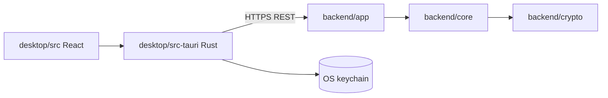
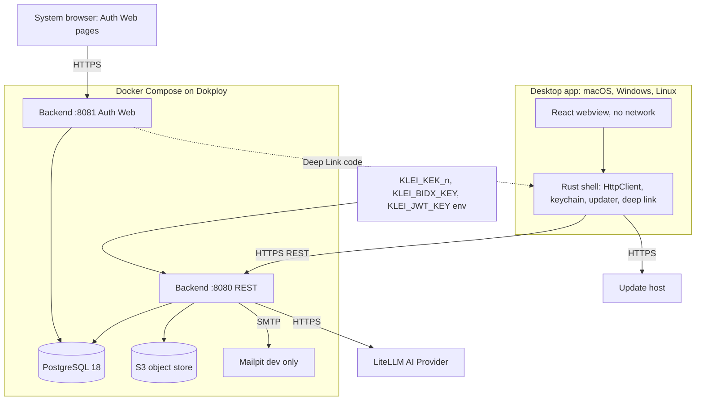
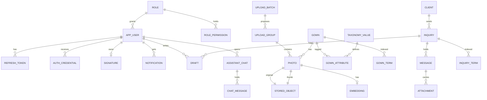
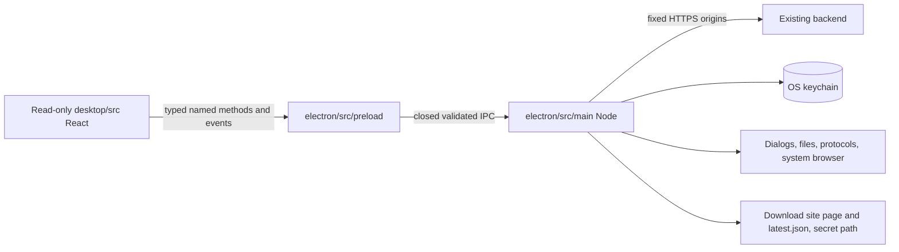

# Architecture Spine: Klei Bridal Dashboard

## Design Paradigm

Modular monolith. One Spring Boot deployable, three Maven modules, dependency direction inward. The desktop app is a Rust shell that owns all network and secret access; the React webview only renders.

| Layer | Namespace | Directory |
| --- | --- | --- |
| Crypto (envelope, blind index, key ring, password and token primitives, Hibernate listener) | `co.klei.crypto` | `backend/crypto` |
| Core (entities, repositories, services, ports) | `co.klei.core` | `backend/core` |
| App (REST controllers, Auth Web, adapters, wiring) | `co.klei.app` | `backend/app` |
| Desktop shell (Rust commands, keychain, updater, deep link) | `src-tauri` | `desktop/src-tauri` |
| Desktop UI (React, no network, no secrets) | `src` | `desktop/src` |

## Invariants & Rules

### AD-1 — Spring Boot, one app, two connectors [ADOPTED]

- **Binds:** FR-4, FR-6, NFR-5, NFR-8
- **Prevents:** A second deployable for the Auth Web, or Auth Web routes reachable on the API port.
- **Rule:** Spring Boot 4.1.x on Kotlin. Tomcat connector 8080 serves `/api/**`; connector 8081 serves the Thymeleaf Auth Web. A port guard returns 404 for Auth Web paths on 8080 and for API paths on 8081. One `ClientIp` resolver (`server.forward-headers-strategy=framework`, one trusted proxy hop) is the only source of client IP for rate limits and audit. Split into two apps only when Auth Web needs separate scaling.

### AD-2 — All cryptography lives in `backend/crypto`

- **Binds:** NFR-1, FR-42
- **Prevents:** Feature code calling `javax.crypto`, `MessageDigest`, `Mac`, `SecureRandom` or a JWT signer directly.
- **Rule:** `CryptoService` is the only class that touches JCA ciphers, HMAC and `SecureRandom`; `ObjectCipher`, `BlindIndex`, `PasswordHasher`, `TokenSigner` and `SecureTokens` are delegates inside `crypto`. `core` and `app` may import only those five, `@Encrypted`, `@EncryptedEntity`, `@BlindIndexed` and `FieldCodec`. ArchUnit fails the build on `javax.crypto`, `java.security.MessageDigest/Mac/SecureRandom` or BouncyCastle imports outside `crypto`. `RewrapJob` lives in `app` and calls a `KeyRotation` API of `crypto`.

### AD-3 — Envelope format

- **Binds:** NFR-1, FR-41
- **Prevents:** Ciphertext that cannot be authenticated, moved between rows or columns, or whose length reveals its value.
- **Rule:** AES-256-GCM with a per-column key `HKDF-SHA-256(tenant DEK, "table|column")` (logical names from `@EncryptedEntity` and `@Encrypted` constants, not DB names), so no key nears the 2^32 random-nonce bound. Fresh random 96-bit nonce per encryption (never counter, never derived). AAD = `version|dek_id|table|column|rowId` (UTF-8). Stored `bytea`: `[version:1][dek_id:16][nonce:12][ciphertext+tag]`. Before encryption, plaintext is framed `[len:4][data][zero pad]` and padded to 32-byte steps up to 256 bytes, then to the next power of two, so length reveals neither enum values nor booleans. `FieldCodec` is the only serializer: UTF-8; Instant = ISO-8601 UTC with millis and `Z`; Boolean = `1`/`0`; numbers = invariant-locale ASCII; enums = lowercase `snake_case`; structured values = `camelCase` JSON of one `@Serializable` class with a top-level `v`. A decrypt failure is an error, never an empty value. `dek_id` is the key version stored with each ciphertext (NFR-1 reading, OQ-6); `kek_version` lives on the `data_key` and `stored_object` rows.

### AD-4 — Key hierarchy and rotation

- **Binds:** NFR-1, NFR-8, FR-41
- **Prevents:** Keys in the DB, repo or image. Rotation that needs a full re-encrypt. One key serving two purposes. A rotation that strands data.
- **Rule:** One tenant DEK (single Workspace), row `data_key` with unique `generation`; first DEK created `INSERT … ON CONFLICT DO NOTHING`. Each stored object has its own DEK on its `stored_object` row. DEKs are wrapped by the active KEK with AES-256-GCM, AAD = `dek|<data_key.id or stored_object.id>`. Env vars: `KLEI_KEK_<n>`, `KLEI_KEK_ACTIVE`, `KLEI_BIDX_KEY`, `KLEI_JWT_KEY` (each also as `…_FILE`). All pairwise distinct and distinct from DB and SMTP passwords, checked at boot. Rotation, one deploy per step: (1) add `KLEI_KEK_n+1`; (2) set `KLEI_KEK_ACTIVE=n+1`; (3) `POST /admin/keys/rewrap` (refused unless active is the highest configured); it updates wrapped DEK columns through raw JDBC and never fires the entity listener; (4) at zero rows on the old version, deploy without the old KEK. Boot fails if any referenced `kek_version` has no KEK. An unknown `dek_id` reloads `data_key` once, then fails. Tenant DEK replacement, `KLEI_BIDX_KEY` rotation and `KLEI_JWT_KEY` rotation are Deferred; the constraints that keep them possible are `dek_id` in every blob and `v1` in every blind index.

### AD-5 — Column allowlist and timestamps

- **Binds:** NFR-1, FR-42
- **Prevents:** A plaintext business column shipping unnoticed. Timestamps leaking behaviour.
- **Rule:** Allowed plaintext columns: `id` and `*_id` (UUIDv4), `seq` on exactly six tables (gown, inquiry, message, notification, audit_entry, ai_usage), `version` (bigint optimistic lock, AD-18), `generation` on `data_key`, envelope columns `wrapped_dek` and `kek_version`, Flyway tables. Everything else is `<name>_ct bytea`, plus `<name>_bidx bytea` where AD-6 lists it. Every time value is `<name>_at_ct`. Tests: a schema test reads `information_schema` and fails on any other column; the leak suite checks that every `_ct` and `_bidx` value in every row parses as an envelope with a padded length.

### AD-6 — Blind indexes, ordering and search scope

- **Binds:** FR-4, FR-13, FR-14, FR-19, FR-28, NFR-1
- **Prevents:** LIKE on ciphertext, two ways to compute one index, silent loosening of the leakage surface.
- **Rule:** Blind index = `HMAC-SHA-256(HKDF(KLEI_BIDX_KEY, "bidx|v1|" + domain), canon(value))`, exact match only. `domain` is the closed enum `BidxDomain`: `APP_USER_EMAIL, CLIENT_EMAIL, INQUIRY_STATUS, INQUIRY_UNREAD, GOWN_DAY, GOWN_TERM, INQUIRY_TERM, CREDENTIAL, REFRESH, IDEM`; `BlindIndex.of(domain, value)` is the only entry point, and a test compares the enum with the table in `docs/architecture.md` §4.2. `canon` = NFKC, collapse whitespace, trim, `lowercase(Locale.ROOT)`. `Terms.of(text)` is the only tokenizer (split on non letters and digits, canon, drop > 64 chars, dedupe, cap 32) for indexing and for queries (count distinct query words). `DayBucket.of(Instant)` = UTC `yyyy-MM-dd`; `DayBucket.lastN(n)` = today and the previous n−1 days, used by Gallery and Dashboard alike. Taxonomy filters use no blind index: `taxonomy_value` is decrypted in memory (tens of rows) and `gown_attribute.taxonomy_value_id` is filtered. Order: `seq` default `nextval`, newest first; the inquiry `seq` is bumped only by `InquiryStateService.touch()`. Search = whole-word terms (`gown_term`, `inquiry_term`), AND of query words, no partial words. Bumping `v1` ships a `ReindexJob`. Accepted leakage is listed in `docs/architecture.md` §4.2 and needs the user's yes (OQ-2, OQ-6).

### AD-7 — Object storage is client-side encrypted behind an S3 port

- **Binds:** NFR-1, FR-8, FR-15, FR-17, FR-21
- **Prevents:** Plaintext in the object store. Lock-in to one S3 vendor. Lost objects and live objects deleted by the sweep. Decoder abuse.
- **Rule:** Body = `[version:1][nonce:12][ciphertext+tag]`, one DEK per object, AES-256-GCM single shot, framed and padded to 64 KB steps (AD-3 framing), AAD = `obj|<bucket>|<objectId>`. Key = random UUID. Content-Type `application/octet-stream`, no user metadata, no tags; S3 `LastModified` is an accepted leak (OQ-6). File name, content type, size live encrypted in the DB. 480 px JPEG thumbnails are separate objects. Write order: `PutObject`, then commit the row. Delete order: commit the row delete, then delete the object in `afterCommit`. The nightly sweep removes objects with no `stored_object` row and `stored_object` rows with no owner, only if older than 24 h. Each object has one owner (`photo.original_object_id`, `photo.thumb_object_id`, `attachment.object_id`, `app_user.avatar_object_id`). Decoding: type from magic bytes, ≤ 25 MB, header size ≤ 40 megapixels, two concurrent decodes at most; the original is stored as uploaded once it decodes; images are served with a fixed Content-Type and `nosniff`. JVM runs with `ExitOnOutOfMemoryError`, no heap dump, and a container memory limit. AWS SDK v2 S3 only, so the store is swappable.

### AD-8 — Authentication through the Auth Web, PKCE, Deep Link

- **Binds:** FR-2..FR-6, NFR-5
- **Prevents:** Passwords entering the webview. Tokens in the bundle or Deep Link. Silent code issuance. Redirect abuse.
- **Rule:** Sign-in, Invitation, verification and reset are Thymeleaf pages on 8081 in the system browser (HTTPS, `__Host-` cookie HttpOnly+Secure+SameSite=Lax, CSRF, CSP, `no-referrer`). `/authorize` always asks for the password; its cookie session lives only for that flow and is destroyed when the code is issued. "Keep me signed in" sets the refresh-token lifetime (24 h, or 30 d). Return = OAuth 2.0 authorization code + PKCE S256 (RFC 8252). `redirect` is compared exactly after parsing: `klei://auth/callback`, or `http://127.0.0.1:<1024-65535>/callback` with no userinfo or query. The code is bound to client, redirect and challenge, single use, 60 s. Links in mail carry their token in the URL fragment; the page posts it. Access token = JWT, EdDSA, 15 min. Refresh = opaque 256-bit, rotating, single use, hash stored; the just-spent token is accepted for 10 s and returns the same successor; later reuse revokes the family and writes an Audit Entry. Password change, reset, user disable or delete and role change revoke the user's families. Passwords: Argon2id, max length 128, two concurrent hashes, hash then wrapped. Verify code: 5 attempts, 15 min; Invitation 7 days; reset link 1 h.

### AD-9 — Authorization is server-side and permission-based

- **Binds:** FR-6, FR-35, FR-36
- **Prevents:** Role checks in the client or by role name. Access that survives revocation.
- **Rule:** Every endpoint declares `@PreAuthorize("hasAuthority('PERM_…')")`, or `@PermitAll`, or `@TokenAuthorized` (the one-time `ai-fetch` URL only); an ArchUnit test fails on any other. The JWT carries `perms[]`, `sid`, `epoch`. Each request checks: `iat` is not before server start, `sid` is not revoked, `epoch` equals the current permission epoch (bumped on any matrix, role, disable or delete change). A failed check is 401 `token_stale`; the shell refreshes, and refresh reloads the user, refuses an inactive user, and re-reads the matrix. Revocation state is in memory (A1). There is no separate integration credential: FR-24 callers are a Staff user. Forbidden = 403 problem+json. Gallery, Search over Gowns and Dashboard Gown figures need `PERM_VIEW_GALLERY` (editable, on for all default Roles). A User whose Role holds no Permission cannot sign in (Auth Web and refresh refuse).

### AD-10 — Rust shell is the only network client

- **Binds:** FR-6, FR-8, FR-17, FR-43, NFR-3, NFR-5, NFR-6
- **Prevents:** Secrets or tokens reachable from JavaScript. Webview calling arbitrary hosts. Two code paths racing the refresh token.
- **Rule:** Webview CSP `connect-src 'none'`. One Rust `HttpClient` module owns token state behind a mutex; every outbound call (commands and the `klei-img://` scheme) goes through it; refresh is single-flight. Access token lives in Rust memory; only the refresh token is in the OS keychain (`keyring`); no keystore means sign-in fails closed. The webview gets a closed command set: `api_request(method, path, body)`, `sign_in`, `sign_out`, `upload_files(kind, targetId)` (`kind` is `photo` or `attachment`; Rust opens the file dialog, reads files, uploads each with its own `Idempotency-Key`, emits progress), `export_gowns(ids ≤ 100)` (Rust opens the save dialog, fetches photos one by one, builds the zip with sanitized names), `check_update`, `install_update`, `set_dirty(bool)`. `api_request` builds the URL on the fixed origin from a path matching `^/api/v1/[a-z0-9/_-]+$` and never follows a cross-origin redirect. Base URLs are build-time constants. Network error, 10 s timeout, 502 and 503 mean offline: banner, `GET /health` every 5 s, Send disabled. No persistent plaintext cache on disk.

### AD-11 — API contract

- **Binds:** all FRs, NFR-2, NFR-3
- **Prevents:** Drift between backend and UI types. Error bodies and URLs that leak content. Lost updates. Double sends.
- **Rule:** Code-first OpenAPI (springdoc); `docs/api/openapi.json` is committed and a test fails on drift; TS types come from `openapi-typescript`. Errors are RFC 9457 `application/problem+json` with `code`, `status`, `correlationId`, `fields[]` (names only) and `extensions` (typed per `code`, for example `usedBy`, `check`). Lists return `{items, next, total?}`, newest first, `limit ≤ 100`, cursor `before=<seq>`; a client never uses `seq` as a watermark; Audit uses offset paging. GET endpoints take only paging parameters; any filter or search is a `POST …/query` with a JSON body, so no business text reaches a URL. Every `PATCH` and `PUT` on a mutable row needs `If-Match: <version>`; mismatch = 409 `conflict`. Every create-style `POST` accepts `Idempotency-Key`, stored as an `idem_bidx`; a repeat returns the first result. Ids are UUIDs; times ISO-8601 UTC.

### AD-12 — AI egress through one port

- **Binds:** FR-9, FR-25..FR-27, FR-37..FR-39, NFR-6
- **Prevents:** Provider calls from the desktop. Plaintext AI data stored. Unlogged egress. Key exfiltration through the base URL.
- **Rule:** Only the backend calls the AI Provider, through `AiProviderPort`, never inside a DB transaction. Every call writes an `ai_usage` row in its own transaction (`REQUIRES_NEW`), including failures. Key is write-only, stored encrypted, never in `.env`. Prompts, responses, usage and chat history are stored encrypted. Base URL: HTTPS only (HTTP behind a dev flag), IP resolved and pinned at connect with loopback, link-local, private, CGNAT, ULA and metadata ranges refused, no redirects, size and time caps, provider body never echoed; changing scheme or host requires re-entering the key and writes an Audit Entry. Assistant context: built by the backend from rows the caller may read, at most 20 items of 2 KB, nothing else. Image delivery to the embedding model is an inline data URI first; fallback is a one-time URL (256-bit token, single use, 60 s, never logged) served by the API host. [ASSUMPTION: spike S-1 confirms `dinov2-base` accepts a data URI.]

### AD-13 — Embeddings are batch-local

- **Binds:** FR-9, FR-11, NFR-1
- **Prevents:** Plaintext vectors in a column or pgvector index. Vectors kept after use.
- **Rule:** One encrypted vector per Photo. Grouping compares vectors in memory inside one Upload Batch (≤ 200, enforced under `FOR UPDATE` on the batch row). Vectors are deleted at Save or Discard. One active batch per user (`upload_batch.user_id` unique; the row is deleted at Save or Discard). Vector length is read from the response. No catalog-wide similarity in MVP.

### AD-14 — Logs, errors and mail carry no content

- **Binds:** NFR-6, FR-5, FR-34
- **Prevents:** PII in logs, error bodies, URLs, SMTP or Mailpit.
- **Rule:** Log fields are ids, codes, counts, durations. Entities never have `toString()` or `data class` equality over decrypted fields (ArchUnit). `server.error.include-message=never`; Hibernate SQL and bind logging off in prod; parse and validation errors map to fixed codes. Tomcat and proxy access logs record method and status only, no query string and no `Authorization`. Outbound mail is exactly the templates in PRD §7.1; Reply mail to a Client is the only mail with content. Every mail goes through `MailPort`, built with `MimeMessageHelper`, CR/LF and path separators stripped from subject and file names; STARTTLS and certificate checks required outside dev. Mail is sent asynchronously, so response time does not reveal whether an account exists.

### AD-15 — Updates

- **Binds:** FR-43, NFR-4
- **Prevents:** Unsigned update payloads. Updater key in the repo. Losing unsent work on restart.
- **Rule:** Tauri updater with a minisign key pair; public key in `tauri.conf.json`, private key only in the CI secret store with an offline escrow copy; a key-rotation release is signed by the old key. Check at start and every 24 h. Install only on confirmation, and not while `set_dirty(true)` (unsent Draft or Upload review). Request carries version, OS, arch only. Update host is a separate public releases repo with signed installers and `latest.json` only (OQ-3, approved); the private source repo never serves updates.

### AD-16 — Deployment and secrets

- **Binds:** NFR-8, NFR-9
- **Prevents:** Secrets in the repo or image. Unreproducible environments. Two versions running at once.
- **Rule:** `infra/docker-compose.yml` runs backend, PostgreSQL, S3 store, Mailpit (dev profile only). Production is the same compose deployed by Dokploy, which stops the old container before starting the new one (A1 state is in memory); proxy terminates TLS and routes API and Auth Web to separate domains. Secrets are Dokploy env vars (or `…_FILE` mounts) with an offline copy kept apart from backups. `.env` is git-ignored; `.env.example` is committed. First Admin is created at startup from `KLEI_BOOTSTRAP_ADMIN_*` when no Admin exists; the operator then removes those variables. Flyway runs at startup, forward-only; rollback = restore the backup plus the previous image. Actuator exposes `health` only (`/health` liveness, `/health/ready` DB and store). Backups: DB dump first, then bucket copy; the integrity report lists rows whose object is missing. Environments: dev compose and production; CI runs the compose. No telemetry. Production images pinned by digest.

### AD-17 — Verification is part of the build

- **Binds:** FR-42, NFR-2, NFR-4, NFR-9, SM-3
- **Prevents:** Encryption claims that nothing tests.
- **Rule:** `mvn verify` runs the leak suite: insert Sentinels through the API (users, Clients, Inquiries, Replies, prompts, filenames, audit), including base64, hex and URL-encoded forms; drive failure paths (failing SMTP, stub AI error, malformed JSON, oversize upload); dump every table with SQL and `pg_dump`; list every bucket key, read every object and its metadata; scan logs, Tomcat access logs and Mailpit (a system mail may carry its recipient address only); assert no Sentinel; run once more after a rotation to `KLEI_KEK_ACTIVE=2`. Also: column allowlist and envelope-shape test (AD-5), ArchUnit (AD-2, AD-9, AD-14, AD-19), blind-index enum test (AD-6), OpenAPI drift (AD-11). The test S3 image is pinned independently of the production choice. CI builds, installs and launches the desktop app on macOS, Windows and Linux, and runs a seeded 5,000-Gown timing test for NFR-2.

### AD-18 — Concurrency and atomic state

- **Binds:** FR-3, FR-4, FR-16, FR-35, FR-36, NFR-3
- **Prevents:** Read-modify-write races on ciphertext (no SQL can compare or increment it).
- **Rule:** Every mutable table has a plaintext `version bigint` (`@Version`). Single use of a credential means deleting its row: success iff one row was deleted. A refresh token is spent by a version-checked update that records the successor; the loser re-reads and gets the same successor inside the 10 s window. A counter that must be exact (code attempts) is updated under `SELECT … FOR UPDATE` on its row inside the transaction, or lives in memory. Cross-row invariants (last Admin, Taxonomy value in use, batch size) lock the owning parent row. A set (a role's Permissions) is replaced whole under a lock on its parent. Singleton rows (`ai_setting`, `workspace`) have a fixed id created with `INSERT … ON CONFLICT DO NOTHING`.

### AD-19 — Persistence discipline

- **Binds:** NFR-1, NFR-2
- **Prevents:** Plaintext or double-encrypted writes through paths the listener cannot see.
- **Rule:** Encryption runs in a Hibernate listener (PreInsert/PreUpdate encrypt into the event state, PostLoad decrypts into transient fields) that re-encrypts only fields whose plaintext changed. Entities with `@Encrypted` fields are written only through the entity API. JPQL or native `UPDATE`/`INSERT` on a table with `_ct` or `_bidx` columns is forbidden outside `@RawCiphertext` repositories (ArchUnit); deletes by id are allowed. Every `*_bidx` column has an `@Encrypted` source field in the same entity. Lists read through `@Immutable` view entities, never `select new`. Derived rows (`gown_term`, `inquiry_term`) are written only by `TermIndexer` in the same transaction, with unique `(owner_id, term_bidx)`. Flyway data migrations that touch encrypted columns are Kotlin `JavaMigration` classes using `MigrationCrypto`; crypto beans start before Flyway.

### AD-20 — Background work and outbound calls

- **Binds:** FR-9, FR-21, FR-41, NFR-3
- **Prevents:** Jobs nobody owns. External calls holding a transaction. Replies sent twice or never.
- **Rule:** No job table (A1). Scheduled tasks are in-process `@Scheduled`, idempotent and resumable by a predicate: re-wrap (`kek_version < active`), orphan sweep, expired credential sweep. On startup, a batch left in `processing` becomes `error` ("interrupted, Retry"). No SMTP, AI or S3 call runs inside a DB transaction. A Reply is committed with `mail_state=pending`, then sent in `afterCommit` (`sent` or `failed`); the Message retry endpoint re-sends the same Message; a repeated `Idempotency-Key` returns the first Message. Mail retry is user-driven only.

### AD-21 — Single writers

- **Binds:** FR-19, FR-22, FR-29, FR-40
- **Prevents:** Two stories writing the same state with different rules.
- **Rule:** `AuditService.record(AuditAction, detail)` is the only writer of `audit_entry`; actions are a closed enum; it joins the caller's transaction, and security events (lockout, token reuse, privileged 403) use `REQUIRES_NEW`. Failed sign-ins are counted in memory; only a lockout is audited. `NotificationPort.publish(type, target, recipients)` is the only writer of `notification`; `type` is a closed enum, `target` a sealed reference, delivery in `afterCommit`. `InquiryStateService` is the only writer of `inquiry.status` and `unread`: a Client message sets New and unread (and reopens Closed); a Reply sets Replied and read; Close sets Closed (needs Close inquiries); opening clears unread. Unread is one flag per Inquiry for the Workspace.



## Consistency Conventions

| Concern | Convention |
| --- | --- |
| Naming | Kotlin packages `co.klei.{crypto,core,app}`; tables `snake_case` singular; encrypted columns `*_ct`, blind indexes `*_bidx`; REST paths plural kebab `/api/v1/gowns`; permission authorities `PERM_UPLOAD_IMAGES` style |
| Ids and ordering | UUIDv4 generated in the app; `seq bigint` (six tables only, AD-5) for order only; `version bigint` on mutable rows |
| Data formats | JSON `camelCase`; ISO-8601 UTC; errors problem+json (AD-11) |
| Crypto | Entity fields annotated `@Encrypted`; blind index via `@BlindIndexed(domain = …, of = "email")`; scalars and JSON through `FieldCodec`; no manual `encrypt()` calls in services |
| Config | Env vars only, `KLEI_` prefix everywhere (`KLEI_KEK_<n>`, `KLEI_KEK_ACTIVE`, `KLEI_BIDX_KEY`, `KLEI_JWT_KEY`), bound by one `@ConfigurationProperties`; no defaults for secrets |
| Logging | Structured, ids and codes only, `correlationId` on every line |
| Tests | Unit with JUnit 6 + MockK; integration with Testcontainers PostgreSQL; desktop with Vitest + `cargo test` |
| Unread and status | One flag per Inquiry for the Workspace; written only by `InquiryStateService` (AD-21) |
| Migrations | Flyway SQL `V<n>__<name>.sql`, forward-only, never edited after merge |

## Stack

| Name | Version |
| --- | --- |
| JDK (Temurin LTS) | 25 |
| Maven (via wrapper) | 3.9.16 |
| Spring Boot | 4.1.2 |
| Spring Framework / Security | 7.0.10 / 7.1.2 |
| Kotlin | 2.3.21 |
| Hibernate ORM | 7.4.13.Final |
| Flyway | 12.4.0 |
| PostgreSQL server / JDBC | 18.6 / 42.7.14 |
| Thymeleaf | 3.1.5.RELEASE |
| AWS SDK v2 S3 | 2.57.11 |
| Argon2 (BouncyCastle) | bcprov-jdk18on 1.86 |
| OWASP Java HTML Sanitizer | 20261103.2 |
| TwelveMonkeys ImageIO WebP | 3.15.3 |
| springdoc-openapi | 3.2.0 |
| Testcontainers / JUnit / ArchUnit / MockK | 2.0.5 / 6.0.3 / 1.5.1 / 1.14.11 |
| Boot-managed pins (Hibernate, Flyway, Kotlin, JUnit) | Follow the Boot 4.1.2 BOM; never override them |
| Mailpit | v1.33.0 |
| Object store | SeaweedFS `chrislusf/seaweedfs:4.52` (Apache-2.0), digest `sha256:57877e32bb90073b37dc109b438ba66e84fd5ed9ced5f5c04f56444ef243ce59` pinned in production; `server -dir=/data -s3 -volume.max=0` (OQ-1) |
| Tauri / CLI / API | 2.12.5 / 2.12.4 / 2.12.4 |
| Tauri plugins updater / deep-link / single-instance | 2.14.1 / 2.6.3 / 2.5.5 |
| Rust (stable) | 1.99.1 |
| keyring (crate) / reqwest / tokio | 4.2.0 / 0.13.5 / 1.54.1 |
| Node (dev) | 24 |
| React / Vite / TypeScript | 19.3.1 / 8.3.6 / 5.9.3 (TS 7 conflicts with the `openapi-typescript` peer range) |
| Vitest / TanStack Query / react-router | 5.1.0 / 5.107.1 / 8.5.1 |
| TipTap (rich-text composer) / DOMPurify | 3.33.0 / 3.4.17 |
| openapi-typescript | 7.13.0 |

## Structural Seed

Container view:



Core entities (names and relationships only; field table in `docs/architecture.md` §4):



Source tree:

```text
/
  backend/   # pom.xml parent; crypto/, core/, app/; mvnw
  desktop/   # Tauri: src/ (React), src-tauri/ (Rust), package.json
  infra/     # docker-compose.yml, Dockerfile, .env.example, ci/
  docs/      # prd, ux-spec, architecture, api/openapi.json, epics/, stories/
```

## Capability → Architecture Map

| Capability / Area | Lives in | Governed by |
| --- | --- | --- |
| Auth, Invitation, verify, reset (FR-1..FR-6) | `app` Auth Web + `core` auth service | AD-1, AD-8, AD-9, AD-18 |
| Dashboard (FR-7) | `app` + `core` | AD-9, AD-11 |
| AI Upload (FR-8..FR-12) | `core` upload service, `app` AI adapter | AD-7, AD-12, AD-13 |
| Gallery (FR-13..FR-18) | `core` gown service | AD-5, AD-6, AD-7, AD-18, AD-19 |
| Inquiries, Reply, Assistant (FR-19..FR-27) | `core` + `app` mail and AI adapters | AD-6, AD-12, AD-14, AD-20, AD-21 |
| Search, Notifications (FR-28..FR-29) | `core` | AD-6, AD-19, AD-21 |
| Settings, Admin, Audit (FR-30..FR-40) | `core` + `app` | AD-9, AD-12, AD-18, AD-21 |
| Key rotation, leak suite (FR-41, FR-42) | `crypto`, `app` tests | AD-3, AD-4, AD-17 |
| Updates (FR-43) | `desktop/src-tauri` | AD-15 |
| Offline and connection loss (NFR-3) | `desktop` | AD-10, AD-11, AD-20 |
| Packaging (NFR-4) | `desktop`, `infra/ci` | AD-15, AD-16, AD-17 |
| Performance (NFR-2), operations (NFR-8) | `core`, `infra` | AD-6, AD-11, AD-16, AD-17 |
| Accessibility (NFR-7) | `desktop`, Auth Web templates | `docs/ux-spec.md`, not an architecture decision |

## Deferred

| Item | Why it can wait / constraint until then |
| --- | --- |
| OQ-1 object store | Resolved 2026-11-08 by the user: SeaweedFS. Verified with the planned S3 calls (create bucket, put, head, get, list, delete, bad credentials denied). `-volume.max` defaults to 8 volumes of 30 GB (about 240 GB) and then refuses writes, so compose sets `-volume.max=0` (auto from free disk) and `-volume.minFreeSpace`. |
| OQ-2 order-only `seq` columns are plaintext | Accepted by the user 2026-11-08. On six tables (gown, inquiry, message, notification, audit_entry, ai_usage); reveals order and volume, and correlates with time through S3 and WAL metadata (AD-5, AD-6). |
| OQ-3 update host | Resolved 2026-11-08 (user "approved" the recommendation): source repo stays private; a separate small public releases repo holds only signed installers and `latest.json`, filled by `tauri-action` cross-repo upload from private CI. No token in the app (AD-15). |
| OQ-4 Hibernate listener instead of AttributeConverter | Accepted by the user 2026-11-08. Row id in AAD forces it; story 1.3 proves it; fallback recorded in `docs/architecture.md` §5.3. |
| OQ-5 KEK offline backup holder and rotation cadence | Cadence accepted 2026-11-08: yearly and on staff exit. Holder not named; defaults to the operator (the user) until told otherwise. Written in the operations doc. |
| OQ-6 NFR-1 readings and accepted leakage | Accepted by the user 2026-11-08: (a) `dek_id`, not `kek_version`, is the key version stored per ciphertext; (b) status, unread, day-bucket, word-term indexes leak group sizes and word frequency; (c) plaintext FKs (which rows belong together) and S3 `LastModified`; (d) per-column HKDF keys. |
| Tenant DEK replacement, `KLEI_BIDX_KEY` rotation, `KLEI_JWT_KEY` rotation | Not required by NFR-1. Constraints kept: `dek_id` in every blob, `v1` in every blind index, `kid` in every JWT. |
| Spike S-1 image delivery to embedding model | Acceptance: one `/v1/embeddings` call with a data URI returns a vector of the configured length. Else one-time URL (AD-12). |
| Spike S-2 Deep Link on Linux AppImage and .deb | Acceptance: a `klei://` link opens the running app on each OS; Windows and Linux relaunch with the URL as an argument (needs `single-instance`); AppImage registers the scheme at runtime; else loopback fallback. |
| Spike S-3 updater and keychain on unsigned builds per OS | Acceptance: update installs and the refresh token still reads after the update (macOS keychain ACL, Windows 2.5 KB credential cap, Linux Secret Service). |
| Spike S-4 CSP `connect-src 'none'` with Tauri IPC and `klei-img://` | Acceptance: images and API calls work; no CSP violation in the console. |
| Catalog-wide similarity, pgvector | Not in MVP (AD-13). |
| KMS or HSM for KEK | Env vars with offline backup for MVP (AD-4, AD-16). |
| Retention and deletion policy | PRD OQ; default keep until deleted by an Admin. Audit and AI usage grow unbounded until decided. |
| Outbound SMTP provider (production) | Mailpit in dev. Invitation, verify and reset need a real provider before go-live; chosen at deploy time (owner: operator). |
| Public Inquiry intake, integration credentials | PRD non-goal; FR-24 callers are a Staff user (AD-9). |
| Dark mode, i18n, offline cache | Out of MVP (PRD §9.2). |

## Electron Migration Scope and Authority

**Scoped authority notice:** This addendum governs only the proposed Electron migration from frozen baseline `8e2eca27f91f5bfcd7a146961d603117bf8a597b` (re-baselined in Stories 21.5 and 21.7; first frozen at `51949da2a0f8347c5f1f56fc5d87d8ada6e60643`). Existing AD-1–AD-21 and FR-1–FR-44 remain authoritative for the protected Tauri product. AD-22 onward apply only to the Electron target; they neither amend Tauri behavior nor authorize implementation, cutover, retirement, or deletion. `docs/brownfield-architecture.md` inventories current contracts; `docs/architecture.md` carries target detail. Reviewers record PASS/CONCERNS/FAIL; the owner decides any pilot, cutover, or separate retirement action. No deployed users: fresh install, no Tauri-token import or cross-framework update.

### Target paradigm

Main-process-owned Electron desktop shell with an isolated React renderer. Node main owns credentials, networking, files, and native operations; narrow typed preload is the only renderer boundary. Keep original renderer source read-only; prefer an Electron-owned Vite alias for the sole `@tauri-apps/api/core` import, with a baseline-SHA-recorded Electron-owned copy as fallback only if read-only build qualification fails.



### AD-22 — Isolated Electron target [ADOPTED]

- **Binds:** MFR-1, MFR-7
- **Prevents:** Electron work changing the frozen Tauri product or sharing mutable build/dependency artifacts with it.
- **Rule:** Keep `desktop/**`, `backend/**`, `infra/**`, `prototype/**`, `docs/api/**`, existing workflows and lockfiles byte-identical to the baseline. All Electron dependencies, lockfile, sources, tests, scripts, configuration, outputs and caches belong under root `electron/`; no Electron build writes under `desktop/`. The one exception is workflow YAML: GitHub reads it only from `.github/workflows/`, so Electron workflows are new files named `electron*.yml` (additions, never edits), and every script and config they call lives under `electron/`. Enforce protected-path and allowlist checks before merge.

### AD-23 — Hardened process boundary

- **Binds:** MFR-1, MFR-3
- **Prevents:** Renderer access to Node, credentials, arbitrary IPC, filesystem, shell, network, or untrusted navigation.
- **Rule:** Electron windows set `contextIsolation: true`, `sandbox: true`, `nodeIntegration: false`; apply restrictive CSP, deny untrusted navigation and popups, and verify the trusted frame/origin on every IPC call. Validate all inputs at the main boundary. Preload exposes only named typed methods; never expose generic `invoke`, raw IPC, Tauri internals, shell/filesystem APIs, or renderer-supplied URLs.

### AD-24 — Closed compatibility shim

- **Binds:** MFR-2, MFR-3
- **Prevents:** Renderer behavior drift or a general command-dispatch capability bypassing the process boundary.
- **Rule:** Reproduce the nine existing command contracts through a closed internal allowlist and explicit typed preload methods. Reuse `desktop/src/bridge.ts` contracts without editing original source; alias its sole Tauri core import where qualified, otherwise use only an Electron-owned SHA-recorded copy. Implement `Channel` through separately registered, schema-validated listeners with unsubscribe, event-sequence validation, explicit cancellation, and request/window-lifecycle cleanup. No raw command name or arbitrary dispatch crosses preload. Owner-approved exception (2026-11-13): only if story 14.4 records that the alias route cannot work, preload may accept a command name for exactly the nine allowlisted names, validated before any handler runs, with no other dispatch.

### AD-25 — Main-owned session and API [ADOPTED]

- **Binds:** MFR-2, MFR-4
- **Prevents:** Token exposure, refresh races, API-origin drift, or divergent validation and errors.
- **Rule:** Main owns fixed API/Auth origins, HTTP, access-token memory, refresh-token persistence, PKCE, refresh serialization, one 401 retry, and bridge errors `{kind,message}`. Preserve method/path/body validation, read-only `/health/ready` exception, `ifMatch`, `idempotencyKey`, timeouts, and safe error text. Preserve `session_only`, sign-in/out, dirty-state and all nine commands. Tokens, local paths, response secrets, and arbitrary server error bodies never enter renderer responses or logs.

### AD-26 — Native operations and persistence [ADOPTED]

- **Binds:** MFR-2, MFR-5
- **Prevents:** Lost native behavior, unsafe image paths, orphaned work, or business content persisted outside the requested export.
- **Rule:** Port Rust I/O behavior to Node in Electron main; no sidecar. Preserve all upload kinds (`photo`, `dropped`, `attachment`, `avatar`, `cancel`, `watch`, `unwatch`), preflight/triage, three workers, retry, idempotency, cancellation, watched-window drop events and 10 s TTL, attachment/avatar limits, export progress/cancel/sanitization/partial-file cleanup/single-export lock, and image protocol route validation. Preserve bounded in-memory thumbnail caching and Windows `klei-img.localhost`; full images and avatars remain uncached. Main alone reads selected files and writes the ZIP only to the user-chosen path. Persist no business content in Chromium caches, app storage, logs, or temporary files; require a persistence-sentinel audit. Preserve clipboard, `execCommand('insertText')`, `beforeunload`, hash routing, focus and accessibility behavior.

### AD-27 — Separate app identity and protocol ownership [ADOPTED]

- **Binds:** MFR-1, MFR-4, MFR-8
- **Prevents:** Preview credentials/profile collisions or interference with Tauri's `klei://` handler.
- **Rule:** Preview uses `co.klei.bridal.electron.preview`, a separate profile and keychain entry, and loopback auth; it does not claim `klei://` or interfere with Tauri testing. Select stable production bundle ID and protocol ownership before first public release. With no deployed users, require fresh install; do not migrate Tauri tokens or installations.

### AD-28 — Manual update exception [ADOPTED]

- **Binds:** MFR-2, MFR-6
- **Prevents:** Renderer-controlled external URLs, false parity claims, or promises of installer verification/restart.
- **Rule:** The Electron Update action opens the download site's page (AD-32; one fixed build-time HTTPS base URL whose path is a long secret token) in the system browser after the dirty-work guard. `check_update` may read only a bounded version manifest from that same site; validate shape/version, timeout, response size, and no redirects. `install_update` is a compatibility name for opening that page after the guard. Electron-only UI says “Download update” / manual install, never “Install and restart.” This is the sole approved Electron-only exception to FR-43/AD-15. No automatic downloader, installer, restart, `electron-updater`, Minisign verification, or signed-version-binding claim. Unsigned macOS Gatekeeper warnings or blocks remain a release risk; do not recommend bypassing them. The app is for internal use and carries no signing certificate.

### AD-29 — Isolated packaging and operational qualification

- **Binds:** MFR-7
- **Prevents:** Electron releases modifying Tauri pipelines or claiming unqualified platform support.
- **Rule:** Keep Electron packaging and CI/release isolated: build config, scripts and outputs under `electron/`, workflow YAML only as new `.github/workflows/electron*.yml` files (the protection job has no path filter), with isolated outputs, credentials and `electron-v*` tags; existing workflows remain unchanged. Qualify fresh install, manual upgrade, reinstall, rollback, keychain, protocols, persistence and performance on every declared OS. Provisional recommendation only: macOS 15+ arm64/x64, vendor-supported Windows 11 x64, Ubuntu 24.04 LTS x64; support remains conditional on the chosen maintained Electron security support, hardware needs, and minimum/current runtime qualification. No paid Apple Developer membership, signing keys, or release credentials are assumed; the download site (AD-32) is the only release host.

### AD-30 — Parity evidence and performance gates

- **Binds:** MFR-2, MFR-8
- **Prevents:** Browser mocks or screenshots being mistaken for native proof, or silent relaxation of existing budgets.
- **Rule:** Preserve UI, interactions, accessibility, session, persistence, and native-operation contracts. Compare screenshots/interactions at 1440×900, 1280×800, and 1100×700; assess focus, toast and accessibility separately from screenshot normalization. Retain cold-start ≤3 s and idle memory ≤300 MB across the complete process tree. Browser mocks are not native-runtime evidence. Require actual per-OS Tauri/Electron runtime evidence for auth, keychain, dialogs/files, protocols, single-instance, update page and packaged lifecycle.

### AD-31 — Cutover and retirement authority

- **Binds:** MFR-8
- **Prevents:** Documentation completion or an internal Electron build being treated as production approval.
- **Rule:** Keep Tauri usable until parity, security, packaging and rollback gates pass; incomplete Electron builds remain internal-only. Define rollback triggers and rehearse rollback before any cutover. Reviewers assess evidence and record PASS/CONCERNS/FAIL; only the owner authorizes a pilot, cutover, or separately gated Tauri-retirement decision. No deletion is authorized here.

### AD-32 — Download site [ADOPTED]

- **Binds:** MFR-6, MFR-7
- **Prevents:** Installers or the update manifest being coupled to the backend, or reachable by a visitor who does not hold the URL.
- **Rule:** Electron installers and the version-only manifest are served by a separate read-only Spring Boot + Thymeleaf application in `electron/download-site/`, on its own port (default 8090), sharing no code, port, secret, image or database with `backend/`. Every route sits under one secret path token of at least 43 characters from `[A-Za-z0-9_-]`; any other path, method or malformed name returns an empty 404. The token is compared in constant time, never logged, and compiled into the app inside one build-time base URL. Responses carry no-referrer, noindex and no-store headers and a closed CSP; the page has no JavaScript and no third-party origin. The secret path is a capability URL, not access control: rotation means reinstalling the app. No certificates are used; SHA-256 values are shown for optional comparison. Releases arrive only from the 19.4 workflow; the site accepts no upload.

### Electron migration deferred

| Item | Constraint / revisit |
| --- | --- |
| Maintained Electron and keychain/ZIP dependency versions | Select and verify during 14.3/15.1 qualification; do not assume `safeStorage` plus a file matches OS-keychain guarantees. Do not pin unverified versions here. |
| Packaging tool and production bundle ID | Decide before distribution (14.3, 15.1, 20.4); no signing keys or release credentials are implied to exist. |
| Download-site server, public host name, HTTPS proxy, final port, token value and deploy credential | Owner provides before distribution (OQ-M5); none exists yet. |
| Supported OS minimums | Owner-approved 2026-11-13: macOS 15+, Windows 11, Ubuntu 24.04 LTS; stays conditional on the selected Electron release's support window and on minimum/current real-runtime qualification passing. |
| Cutover and Tauri retirement | Separate owner decisions after 14–20 acceptance; no deletion authorized. |
